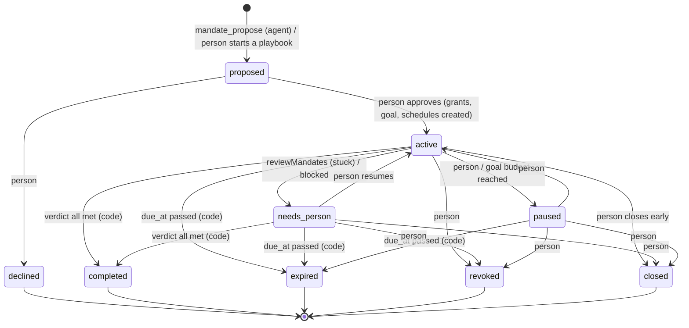

# Operator architecture (track O)

Extends `docs/agent-platform/ARCHITECTURE.md`; read that first. Track O adds
**no new service** and **no change to the task queue**. It adds two tables
(plus a usage log), one SQL function, a registry, a pure matcher, a pure
verdict, a worker pass and some UI. Everything sits behind switches that
default off (DECISIONS OD-13).

**Preconditions on the server (OD-21):** `agents.goals` and `agents.inbox`
must be on. Jobs live on goals; the verdict reads "What I did" episodes,
which `run-task.ts` writes only inside its `if (inbox)` block. Background
check-ins also need `KRIYA_SCHEDULES_ENABLED` on the worker.

Related designs in this folder: Google going live (GOOGLE_CONNECTIVITY.md,
G1–G3), crews whose members act (CREW_EXECUTION.md, O11), and browser
verification of every UI phase (UI_VERIFICATION.md, P-3).

## 1. The job lifecycle



Transitions are enforced by the existing `kriya.allowed_transitions` table
and `kriya.check_transition()` trigger (entity `mandate`), the same
mechanism goals and schedules use. **Who** may make a transition is enforced
in code: the person's server actions (`actions/mandates.ts`) and the worker
pass (`lib/operator/loop.ts`); no tool writes `mandates.status`
(DATA_MODEL §4).

## 2. End to end: a receivables job (OP-COLLECT)

```mermaid
sequenceDiagram
  participant P as Person
  participant W as Worker (runTask)
  participant O as lib/operator
  participant DB as Postgres
  participant G as Gmail / Voice
  P->>W: "Get my overdue invoices paid"
  W->>O: mandate_propose (playbook OP-COLLECT)
  O->>DB: validate (registry, constraints, limits), insert mandate 'proposed'
  W-->>P: mandate card (done criteria, grants, ₹ quote, deadline)
  P->>DB: approveMandate (server action, withUser)
  DB->>DB: goal + thread, grants, kickoff + check-in schedules
  DB->>W: scheduler enqueues kickoff task in the goal thread
  W->>G: gmail_draft (to ⊆ pinned clients)
  W->>O: grant matches? consume_grant (SQL, atomic)
  O-->>W: approved, no Inbox stop
  W->>G: propose_call (draft; never granted)
  P->>G: confirms the exact call (voice D-09)
  G->>DB: call_outcomes accepted ("will pay on 28 Oct")
  W->>DB: schedule once on 28 Oct: check payment (needs approval or person)
  P->>DB: marks invoice paid (person-only)
  O->>DB: reviewMandates: verdict all met → completed
  P->>W: handover report (PDF, share link)
```

## 3. Components

| Path (new unless marked)                                  | Purpose                                                                           | Runs in               | Phase |
| --------------------------------------------------------- | --------------------------------------------------------------------------------- | --------------------- | ----- |
| `lib/agent/capabilities.ts`                               | Registry: one entry per tool, derived from the policy tables plus grant metadata  | web, worker, tests    | O1    |
| `lib/operator/mandates.ts`                                | Validate and create proposals; approve, decline, pause, resume, revoke, close     | web (actions), worker | O3    |
| `lib/operator/grants.ts`                                  | Pure matcher (`grantMatches`), approval composition (`withGrants`), SQL `consume` | worker                | O3–O4 |
| `lib/operator/verdict.ts`                                 | Pure verdict over evidence rows; `loadEvidence` (privileged, scoped by user id)   | worker, web           | O5    |
| `lib/operator/loop.ts`                                    | `reviewMandates()`: stuck, expiry, completion; no model                           | worker                | O6    |
| `lib/operator/playbooks.ts`                               | Playbook constants                                                                | web, worker           | O7    |
| `lib/operator/metrics.ts`                                 | OM1–OM8 SQL aggregates                                                            | web (owner)           | O8    |
| `actions/mandates.ts`                                     | Person's mutations (zod, `withUser`)                                              | web                   | O3+   |
| `queries/mandates.ts`                                     | Reads for pages                                                                   | web                   | O3+   |
| `components/operator/*`                                   | Mandate card, mandate panel, grant row, verdict list                              | web (client)          | O3+   |
| `app/owner/operator/page.tsx`                             | Owner metrics                                                                     | web                   | O8    |
| `lib/operator/crews.ts`                                   | `crew_dispatch` checks, part creation, `reviewCrews()`                            | worker                | O11   |
| `queries/connections.ts`                                  | Derived connection health ("needs reconnect")                                     | web                   | G1    |
| `scripts/verify-guard.ts`, `scripts/verify-model-stub.ts` | Isolated-stack guard; scripted OpenAI-compatible stub (dev only)                  | local                 | P-3   |
| `supabase/migrations/202612…_operator_*.sql`              | Tables, transitions, `consume_grant`, RLS                                         | —                     | O2    |

Boundaries:

- `lib/operator/*` imports no `next/*` (the worker uses it) and nothing from
  `lib/connectors.ts`, `lib/secrets.ts`, `lib/browser/*` or `lib/voice/*`
  runtime code. It **reads** voice and ledger rows through SQL only.
- `lib/operator/grants.ts` `grantMatches` and `lib/operator/verdict.ts`
  `verdict` are pure and synchronous, like `lib/agent/policy.ts`.
- Client components import only types and `lib/operator/labels.ts` (pure
  strings), never the server modules (AGENTS.md convention).
- `kriya-voice` and `kriya-browser` are untouched.

## 4. Capability registry (O1)

```ts title="lib/agent/capabilities.ts (contract)"
export type Capability = {
  tool: string
  risk: RiskClass // always TOOL_CLASSES[tool]; never a second source
  sideEffect: boolean // SIDE_EFFECT_TOOLS.has(tool)
  writes: string[] // TOOL_WRITES[tool]
  system: "kriya" | "web" | "browser" | "google" | "notion" | "github" | "meta" | "voice"
  verification: "api_readback" | "page_check" | "file" | "none"
  undoable: boolean // lib/undo.ts has a compensation
  grantable: boolean // OD-03; only R2/R3 tools in GRANTABLE
  // Fields of the tool input a grant may pin, and how they're compared
  pins?: Record<string, "subset" | "equals">
}
export const CAPABILITIES: Record<string, Capability>
export function disabledTools(setting: string | null): Set<string>
```

Rules:

1. `risk`, `sideEffect` and `writes` are **read from** the existing tables
   at module load; the registry never redefines them. OT-CAP-01 proves every
   key of `TOOL_CLASSES` has an entry and no entry exists without one.
2. Grantable in v1, with pins:

   | Tool                    | Pins                                                               |
   | ----------------------- | ------------------------------------------------------------------ |
   | `gmail_draft`           | `to: subset`, `cc: subset` (absent `cc` matches)                   |
   | `calendar_create_event` | `attendees: subset` (absent = none; a grant with `[]` allows none) |
   | `sheets_append`         | `spreadsheetId: equals`, `range: equals` (the tab-qualified range) |
   | `sheets_update`         | `spreadsheetId: equals`, `range: equals`                           |

3. Kill switch: `operator.disabledTools` (comma-separated). In `runTask`,
   after the belt is built, each listed name is deleted from `tools`. Skill
   replay reads the same belt (`() => tools`), so a killed tool is gone for
   replay too. Unset or empty → no change (OT-REG-01).

## 5. Grants in the runner (O4)

The only runtime change to `runTask` (CHANGE_IMPACT §3):

```ts title="lib/agent/run-task.ts (O4 sketch)"
// After loadContext, only with operator.grants on:
const grants = grantsOn ? await activeGrants(task.userId, task.threadId) : []
const granted = new Map<string, string>() // toolCallId → grantId
const toolApproval = grants.length
  ? withGrants(TOOL_APPROVALS, grants, async (grantId, toolCallId) => {
      const ok = await consumeGrant(task.userId, grantId, task.id, toolCallId)
      if (ok) granted.set(toolCallId, grantId)
      return ok
    })
  : TOOL_APPROVALS
// streamText({ …, toolApproval, … })
// onToolExecutionStart: … grantId: granted.get(toolCall.toolCallId) ?? null
```

`withGrants` (pure composition, `lib/operator/grants.ts`):

1. Compute the base status exactly as today (the value or function in
   `TOOL_APPROVALS`).
2. If the base isn't `"user-approval"`, return it unchanged.
3. If the tool isn't grantable, or no active grant matches every pin,
   return `"user-approval"`.
4. Otherwise call `consume`; `true` → `"approved"`, `false` →
   `"user-approval"`.

`activeGrants(userId, threadId)` returns grants whose mandate is `active`
**and** whose goal's thread is `threadId` **or** a part thread of one of
that mandate's crew runs (O11, CREW_EXECUTION.md), with `status = 'active'`,
`expires_at > now()`, `uses < max_uses`. Any other thread → empty → today's
behaviour exactly.

`consume_grant` (SQL, DATA_MODEL §2.4) locks the grant, re-checks status,
expiry, mandate status and uses, inserts `grant_uses (grant_id,
tool_call_id)` with `on conflict do nothing`, and returns true if the row
exists for that call. A retry of the same tool call is therefore free and
idempotent; a revoke between steps makes the next call ask.

> [!IMPORTANT]
> **Unknown to verify first in O4:** how AI SDK 7.0.137 records an
> `"approved"` status in the UI message parts (whether it emits approval
> parts and how `recordApprovals` and the transcript render them). O4's first
> test (OT-GRT-01) runs the scripted model with a matching grant and asserts
> the saved message, the `approvals` table (no row) and the transcript. If
> the SDK writes approval parts, `recordApprovals` must skip them; that
> one-line filter is listed in CHANGE_IMPACT for O4.

Episodes stay as they are. The receipt hash body (`receiptHash`) does
**not** gain the grant id, so existing chains still verify (AT-RCP-02).
"What I did" shows "under your mandate" by joining `tool_executions.grant_id`
at read time.

## 6. Verdict (O5)

```ts title="lib/operator/verdict.ts (contract)"
export type Criterion = {
  id: string
  text: string
  evidence: EvidenceSpec // DATA_MODEL §3
}
export type Evidence = {
  episodes: { id: string; done: EpisodeAction[]; createdAt: Date }[]
  calls: { voiceTaskId: string; result: string | null; verifier: string }[]
  invoices: { id: string; status: string }[]
  ledger: { id: string; status: string }[]
  files: { id: string }[]
  confirmed: string[] // criterion ids the person ticked
}
export function verdict(criteria: Criterion[], evidence: Evidence): CriterionResult[]
export const allMet = (results: CriterionResult[]) => results.every((r) => r.met)
```

`loadEvidence(userId, mandate)` reads, with `privileged` and an explicit
`user_id = $userId` in every query (invariant 1): episodes of the goal
thread (not deleted), `voice_tasks` with `thread_id = goal thread` joined to
`call_outcomes`, invoices and ledger entries whose ids the mandate lists in
`subjects`, files referenced by those episodes, and the person's ticks.

The handover report is the existing `report` document template
(`lib/documents/templates.ts`), rendered through the existing PDF path and
shareable with the existing K8 links. No new template.

## 7. Responsibility loop (O6)

`reviewMandates()` runs inside `schedulerLoop` (worker), behind
`operator.checkIns`, every scheduler tick, with no model call:

| Condition (per active / needs_person / paused mandate)                                                   | Action                                                       |
| -------------------------------------------------------------------------------------------------------- | ------------------------------------------------------------ |
| `now() ≥ due_at`                                                                                         | `expired`; end schedules; store verdict                      |
| verdict all met                                                                                          | `completed`; end schedules; store verdict                    |
| active, 2 consecutive finished check-in runs since `last_evidence_at`, no pending approval in the thread | `needs_person`; pause schedules (`pause_reason = 'mandate'`) |
| goal paused by its ₹ cap                                                                                 | `paused` (reason budget)                                     |

"Finished check-in runs" are `schedule_runs` of the mandate's schedules
with outcome `enqueued` whose task finished. Idempotent: the same tick twice
changes nothing.

## 8. Failure modes

| Failure                                                | Behaviour                                                                                                 |
| ------------------------------------------------------ | --------------------------------------------------------------------------------------------------------- |
| Worker dies after `consume_grant`, before the tool ran | The use is spent; the task is recovered. Retries of the same tool call id reuse the use (no double count) |
| Tool runs under a grant and its verification fails     | Recorded as today ("not confirmed"); OM3 counts it; the criterion stays unmet                             |
| Person revokes mid-task                                | Next matching call asks (consume re-checks the status)                                                    |
| Grant expires mid-task                                 | Same                                                                                                      |
| Model proposes an over-broad grant                     | `mandate_propose` refuses: not grantable, missing pin, `max_uses` > 50, expiry beyond due date            |
| Prompt injection asks for a new recipient              | No pin match → asks the person, who sees the exact action                                                 |
| Check-ins burn money with no progress                  | Stuck rule after 2 runs; goal ₹ cap; plan daily task limit                                                |
| Evidence row deleted by the person                     | Verdict recomputed: criterion unmet; report says so                                                       |
| Owner kills a tool                                     | It leaves every belt next task; grants for it never match                                                 |
| `operator.*` switch turned off with mandates active    | Grants stop matching (asks again); the loop stops; data stays; turning on resumes                         |

## 9. What doesn't change

`kriya.tasks` and its functions, `lib/agent/metering.ts`, `kriya.charges`,
`lib/billing.ts`, `lib/secrets.ts`, `lib/connectors.ts`, `lib/auth.ts`,
`db/index.ts`, the notifier, `kriya-browser`, `kriya-voice`, every voice
status rule, `receiptHash`, `TOOL_CLASSES` values, `approvalFor`.
