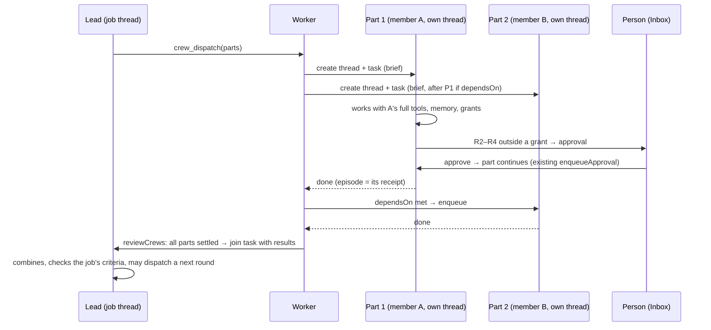

# Crew execution: members who act (track O, phase O11)

## 1. What exists today, and why it can't act

A squad's lead can call `assign` (`lib/agent/tools.ts`, run in
`lib/agent/run-task.ts` `runAssignments`): up to 4 members work **in the
same task**, in parallel, each in its own `streamText` loop. Each member
gets **only memory and web tools**, `writes: false`, and **no connected
accounts** (`run-task.ts`: "nobody can approve a member's web request, so
private data and the web never share its context"). Their text comes back
to the lead, who writes one answer.

So today a crew can **research** in parallel but can't **do**: no drafts,
no calendar, no ledger, no calls. The reason is structural, not a missing
flag: a member runs inside the lead's task, and an approval pauses a
**task**, so a member has no way to wait for the person.

## 2. Design: each part is its own durable task in its own thread



Why this shape:

- **`tasks_one_active_per_thread`** (a unique index, confirmed on the live
  database 2026-10-21) means parallel work needs separate threads. Each
  part gets one.
- Each part is an **ordinary task**: lease, heartbeat, retry, budget stop,
  no retry after side effects, approvals, Inbox, episode and receipt all
  apply unchanged. Nothing in the queue changes.
- Each member works **as itself**: its own model tier, memory scope and the
  full tool belt the switches and plan allow (connectors, ledger, files,
  `propose_call`…). The R0–R5 policy, `guardWeb`, `untrustedSeen` and
  approvals apply per part exactly as for any task.
- **Grants reach parts**: `activeGrants` (ARCHITECTURE §5) matches the job's
  goal thread **or** a part thread of a crew run under that job. Pins still
  apply, so a member can only do what the person granted.
- The person sees every part: its thread, its approvals in the Inbox, its
  "What I did".

## 3. Data (in the O11 migration, `20261201000100_operator_crews.sql`)

```sql title="sketch"
create table kriya.crew_runs (
  id text primary key,
  user_id uuid not null references auth.users (id) on delete cascade,
  lead_thread_id text not null,
  lead_agent_id text not null,
  squad_id text not null,
  mandate_id text,                       -- null outside a job (O11 v1 requires one)
  round integer not null default 1 check (round between 1 and 3),
  status text not null default 'running'
    check (status in ('running', 'joining', 'joined', 'canceled')),
  deadline_at timestamptz not null,
  join_task_id uuid,
  created_at timestamptz not null default now(),
  updated_at timestamptz not null default now(),
  unique (id, user_id),
  foreign key (lead_thread_id, user_id) references kriya.threads (id, user_id) on delete cascade,
  foreign key (mandate_id, user_id) references kriya.mandates (id, user_id) on delete cascade
);
create table kriya.crew_parts (
  id text primary key,
  user_id uuid not null references auth.users (id) on delete cascade,
  run_id text not null,
  agent_id text not null,
  thread_id text not null unique,        -- the part's own thread
  brief text not null check (char_length(brief) between 1 and 1500),
  depends_on text[] not null default '{}',
  status text not null default 'waiting' check (status in
    ('waiting', 'queued', 'working', 'needs_approval', 'done', 'failed', 'canceled')),
  task_id uuid,
  result text check (char_length(result) <= 4000),
  created_at timestamptz not null default now(),
  updated_at timestamptz not null default now(),
  finished_at timestamptz,
  foreign key (run_id, user_id) references kriya.crew_runs (id, user_id) on delete cascade,
  foreign key (thread_id, user_id) references kriya.threads (id, user_id) on delete cascade
);
```

RLS: the person selects their own rows; **only the worker writes**
(explicit deny-all policies for insert/update, as
`20261115000000_database_lint.sql` does for server-only tables).
Transitions in `kriya.allowed_transitions` (`crew_run`, `crew_part`).
`TaskInput` (`db/schema.ts`, a jsonb type) gains
`channel: "crew"` and `partId` / `runId`; existing values unchanged.

## 4. The tool: `crew_dispatch`

| Field   | Value                                                                                                                                                        |
| ------- | ------------------------------------------------------------------------------------------------------------------------------------------------------------ |
| Offered | Only to the lead of a **squad** thread that is a job's goal thread, with `operator.crews` on. Outside jobs the existing `assign` (research only) stays as is |
| Class   | R1. The person already approved the job, its budget and its deadline; each part is still capped (§6)                                                         |
| Input   | `{ parts: [{ key: str(1..12), agentId, brief: str(1..1500), dependsOn?: key[] }] (1..4) }`                                                                   |
| Checks  | Each agent is a squad member and not the lead; keys unique; `dependsOn` acyclic and only earlier keys; no run already `running` for this job; round ≤ 3      |
| Output  | `{ runId, parts: [{ key, agentId, threadId }], note: "Members are working. Their results arrive in this thread when every part settles." }`                  |
| Writes  | `crew_runs+`, `crew_parts+`, `threads+`, `messages+`, `tasks+` (through the queue)                                                                           |

The lead's turn ends after dispatching. It doesn't wait inside its task
(that would hold a lease for minutes and block the job thread).

## 5. The worker pass: `reviewCrews()`

In `schedulerLoop`, behind `operator.crews`, no model, at most 50 runs per
tick, each in its own transaction:

1. **Part status** from its thread: task `queued`/`running` → `working`;
   latest task finished and a pending approval in the part thread →
   `needs_approval`; latest task `succeeded`, no pending approval → `done`
   with `result` = the last assistant message's text (≤ 4000 chars);
   `failed`/`canceled` → same.
2. **Unblock**: a `waiting` part whose `depends_on` are all `done` is
   enqueued; its brief gets the earlier parts' results appended, marked as
   members' reports.
3. **Join**: when every part is `done`, `failed` or `canceled`, or
   `deadline_at` passed (parts still waiting become `canceled`), enqueue one
   task in the lead thread with `channel: "crew"`: per part, the member's
   name, status, result and a link to its "What I did". The run becomes
   `joined`.
4. **Stuck**: a part in `needs_approval` counts as "waiting on the person"
   for the job's stuck rule (O6), never as idle.

Results are members' model text, which may echo untrusted content they
read. The join message carries the existing `FOREIGN` notice, so the lead
treats it as data, not instructions.

## 6. Money, limits and stopping

- Each part task's budget: `min(plan max per task, remaining job budget ÷
parts not yet finished)`, converted with the same `capToProviderMicroUsd`
  that `enqueueScheduled` uses. With no exchange rate set, the plan budget.
- Each part counts against the plan's daily tasks (`prepare()` →
  `checkTaskAllowed`). A part refused for a limit is `failed` with the
  reason; the join says so.
- Per-person concurrency comes from the existing claim rules; parts simply
  queue.
- **Stop crew** (person, job panel) and **Stop all jobs** cancel every
  part's task (`cancelThreadTask`) and mark the run `canceled`.
- Revoking or closing the job does the same.

## 7. What the person sees

- Lead thread: a crew card (like `components/thread/squad-work.tsx`): each
  part's member, brief, live status ("Working", "Needs your approval",
  "Done"), and a link to its thread.
- Part threads are **not** listed on Home or in Tasks (filtered by
  `crew_parts.thread_id`), only reached from the card and the job panel.
- Inbox: part approvals show "for job: <title> · <member>".
- The job's verdict and report include evidence from every part thread.

## 8. Tests

| Id         | Proves                                                                                                                   |
| ---------- | ------------------------------------------------------------------------------------------------------------------------ |
| OT-CREW-01 | `crew_dispatch` refusals: lead as member, non-member, cycle, 5 parts, round 4, second running run, non-job thread        |
| OT-CREW-02 | Dispatch creates one thread and one task per runnable part; dependent parts wait                                         |
| OT-CREW-03 | A member with a Gmail connection drafts under a job grant without an approval; outside the pin it asks in its own thread |
| OT-CREW-04 | A part's R3 approval in the Inbox resumes that part only; the job thread stays free                                      |
| OT-CREW-05 | Dependent part starts only after its dependency is `done` and receives its result                                        |
| OT-CREW-06 | Join enqueues exactly one lead task (idempotent) with every part's status; `FOREIGN` notice present                      |
| OT-CREW-07 | Deadline cancels waiting parts and still joins                                                                           |
| OT-CREW-08 | Budget split and limit refusals as §6                                                                                    |
| OT-CREW-09 | Stop crew / revoke job cancels all part tasks                                                                            |
| OT-CREW-10 | Another person can't read or reach any crew row or part thread (RLS)                                                     |
| OT-CREW-11 | With `operator.crews` off: `assign` unchanged, no `crew_dispatch`, prompt byte-identical (OT-REG-01)                     |
| OG-06      | Golden job: OP-COLLECT with a 2-member crew (one drafts reminders, one prepares the ledger summary); verdict met         |
