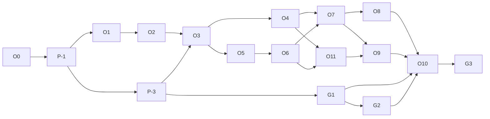

# Implementation plan (operator, track O)

The per-phase checklist (objective, read first, files, tests, exit, status)
is in the root **`status.md`**, section "Operator (track O)", which is
canonical. This document explains order, parallelism, configuration,
rollout and rollback.

## 1. Order and why

| #   | Phase                              | Why here                                                                       | External needs                                                                     |
| --- | ---------------------------------- | ------------------------------------------------------------------------------ | ---------------------------------------------------------------------------------- |
| O0  | Blueprint and decisions            | —                                                                              | Owner approval of OD-01…OD-14                                                      |
| P-1 | Baseline fix (DEF-01)              | Every later preflight needs a green `npm run check`                            | None                                                                               |
| O1  | Capability registry + kill switch  | Grants and playbooks read the registry; the kill switch is useful on its own   | None                                                                               |
| O2  | Data model (one migration)         | Tables before callers; proven by SQL tests alone                               | None                                                                               |
| O3  | Mandate proposal, approval, pages  | The contract exists and is visible before it grants anything                   | None                                                                               |
| O4  | Grant enforcement in the runner    | The one change to agent behaviour; needs OD-02 **and** the AGENTS.md amendment | Owner approval                                                                     |
| O5  | Verdict and handover report        | "Done" must be computable before the loop closes jobs                          | None (`agents.files` for the PDF)                                                  |
| O6  | Responsibility loop                | Needs O5's verdict                                                             | None                                                                               |
| O7  | Playbooks v1                       | Needs O3–O6                                                                    | None (live use needs AB-06, voice 5)                                               |
| O8  | Metrics and owner page             | Needs rows from O3–O7                                                          | None                                                                               |
| O9  | Golden jobs (+ optional paid eval) | End-to-end proof before real accounts                                          | Paid eval: owner go-ahead                                                          |
| P-3 | Isolated verification stack        | Every UI phase ends with a browser check that must not touch the live database | Owner installs Docker + Supabase CLI                                               |
| G1  | Google live in Testing mode        | Real accounts for the owner and testers; visible "needs reconnect"             | Owner: Google Cloud project, consent screen, Render env (GOOGLE_CONNECTIVITY §3.1) |
| G2  | Google actions v2                  | Drive import and share; optional Gmail send                                    | Owner approval for `lib/connectors.ts` (and `verify.ts` with OD-16)                |
| O11 | Crew execution                     | Members act in their own part threads                                          | None                                                                               |
| O10 | Controlled operator pilot          | Real accounts, invited people                                                  | B2/AB-02 staging, AB-06 OAuth, voice 5 for calls, counsel OQ-1                     |
| G3  | Google verification for public use | Before any public launch with Google                                           | Owner, Google, an assessor (cost unknown)                                          |

## 2. Parallelism

1. O1 and O2 may run in parallel (O1 holds `lib/agent/run-task.ts` and
   `lib/config.ts` briefly; O2 holds `db/schema.ts` and
   `tests/db/migrations.test.ts`).
2. After O3: O4 and O5 may run in parallel; both edit
   `lib/agent/tools.ts` / `lib/agent/policy.ts` only if O5 adds
   `mandate_report` — hold them one at a time.
3. O6 holds `worker/index.ts`; not at the same time as any other track's
   phase holding it.
4. **Across tracks:** one migration writer at a time; `run-task.ts`,
   `tools.ts`, `policy.ts`, `instructions.ts`, `worker/index.ts`,
   `lib/config.ts`, `db/schema.ts`, `package.json`, `status.md` are hot spots
   held by one agent at a time (track A IMPLEMENTATION_PLAN §2).
5. Never fix another phase's or track's failing test; record it on the
   board and tell the owner.

## 3. Configuration

All settings in `SETTINGS` (`lib/config.ts`), edited in `/owner/config`.
No new secrets, no new environment variables, no new service.

| Setting                  | Default | Phase      |
| ------------------------ | ------- | ---------- |
| `operator.disabledTools` | empty   | O1         |
| `operator.mandates`      | `off`   | O3         |
| `operator.maxActive`     | `3`     | O3         |
| `operator.grants`        | `off`   | O4         |
| `operator.reports`       | `off`   | O5         |
| `operator.checkIns`      | `off`   | O6         |
| `operator.playbooks`     | `off`   | O7         |
| `operator.crews`         | `off`   | O11        |
| `operator.driveShare`    | `off`   | G2         |
| `operator.gmailSend`     | `off`   | G2 (OD-16) |
| `google.testingMode`     | `off`   | G1         |

Every `operator.*` switch also needs `agents.goals` **and** `agents.inbox`
on (OD-21). Check-ins and crews need `KRIYA_SCHEDULES_ENABLED` on the
worker. Google tools need `GOOGLE_CLIENT_ID`/`SECRET` and the same
`KRIYA_TOKEN_KEY` on web **and** worker.

## 4. Rollout

Dark → owner's account → `agents.allowList` → plans that include it, as
track A §5. Each step recorded in `status.md` with the date. Order of
switches: `mandates` → `reports` → `checkIns` → `grants` → `playbooks`.
Grants go last so the owner first sees jobs that ask for every action.

## 5. Rollback

| Phase | Rollback                                                                                                                              |
| ----- | ------------------------------------------------------------------------------------------------------------------------------------- |
| O1    | Clear `operator.disabledTools`                                                                                                        |
| O2    | Down migration (tested); no callers before O3                                                                                         |
| O3    | `operator.mandates` off: tools and UI gone; rows stay                                                                                 |
| O4    | `operator.grants` off: every call asks again, immediately (read per task)                                                             |
| O5    | `operator.reports` off                                                                                                                |
| O6    | `operator.checkIns` off: the loop stops; schedules keep their own state (pause them with "Stop all" if needed)                        |
| O7    | `operator.playbooks` off                                                                                                              |
| O8    | Hide the owner link                                                                                                                   |
| O11   | `operator.crews` off: no new dispatches; running parts finish as ordinary tasks; "Stop crew" cancels them                             |
| G1    | Remove `GOOGLE_CLIENT_ID`/`SECRET` from Render (Google shows "Not available"; connections stay, revocable from Google's account page) |
| G2    | `operator.driveShare` / `operator.gmailSend` off                                                                                      |
| P-3   | Nothing to roll back in the product; `supabase stop`                                                                                  |
| All   | Owner emergency: `operator.grants` off + each person's "Stop all jobs" revokes everything in one transaction                          |

## 6. Branching and commits

Same as track A §7: a branch per phase only if the owner authorises
commits; otherwise uncommitted on `main`. Conventional Commits
(`feat(operator): …`, `test(operator): …`). Never push to `origin`.
