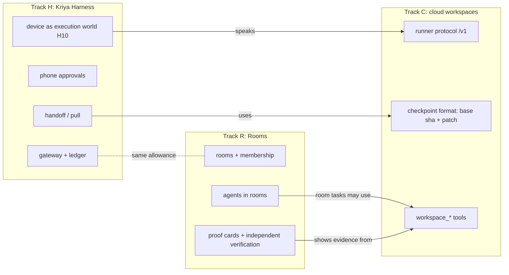

# Program: cloud execution (C), Kriya Harness (H), Rooms (R)

How the three tracks fit together, the order parallel agents implement
them in, the files they share, and the cross-track decisions (PX-…). Each
track's own documents stay authoritative for that track:
`docs/cloud-execution/`, `docs/kriya-harness/`, `docs/rooms/`.

## 1. How they connect

| Link | What it means | Where decided |
| --- | --- | --- |
| H → C checkpoints | `kriya handoff` uploads a track C checkpoint; the cloud workspace restores it | HD-11, CD-13, CD-27 |
| H → C runner | The device world (H10) serves the same runner protocol | HD-12, CD-26 |
| R → C workspaces | A room task runs in the agent owner's bridge thread; it may open a workspace there (the owner's, not shared) | PX-07 |
| R ↔ H agents | A device's agent is an ordinary Kriya agent; it can be added to rooms; room mentions run in `kriya-worker`, never on someone's machine | PX-08 |
| All → allowance | Cloud tasks, voice, harness charges share one plan allowance (`usageSummary`); room tasks are ordinary tasks of each owner | HD-07, RD-17 |

## 2. Cross-track decisions and findings (PX-…)

| Id | Finding / decision | Resolution | Owner-gated |
| --- | --- | --- | --- |
| PX-01 | Three tracks add migrations; order matters | Ranges: C `202702…`, H `202703…`, R `202704…`; one migration writer at a time across all tracks; staging applies in timestamp order | — |
| PX-02 | Handoff and pull (H8) run on `kriya-web`, which must not import `lib/cloud` (CT-IMP-03) | The checkpoint object path and the workspace row rules live in a pure `lib/cloud/paths.ts` (no env, no provider); CT-IMP-03 allows web imports of that file only | — |
| PX-03 | Live notifications for harness approvals (H5) and room mentions/disclosures (R3/R4) need `app/api/events/route.ts` and the notifier, protected by track A | One combined owner-approved change adding `harness-approval`, `room-mention`, `room-disclosure` events, each behind its track's switch; without approval, both tracks fall back to Inbox and unread counts | **Yes** |
| PX-04 | Shared hot spots | §4 schedule; one holder at a time | — |
| PX-05 | Prerequisite switches | Rooms with agents need `agents.inbox` (episodes); repository flows (C5, H8) need `agents.connectors` and a GitHub connection | — |
| PX-06 | H10 adds provider `device` to `kriya.workspaces.provider` (track C's table) | A new migration in H10 widens the check (drop-and-recreate, the `resource_usage` precedent); C's code treats unknown providers as unavailable | — (H10 decision) |
| PX-07 | Rooms + workspaces | No shared workspaces in v1: each agent's workspace is its owner's; members see proof cards (links, change counts) only | — |
| PX-08 | Rooms never execute on people's machines | Room invocations create cloud tasks only | — |
| PX-09 | `proxy.ts` changes from H (`TOKEN_API`, `/connect/`) and R (`/rooms`) | Separate list entries; H2 and R2 serialize on the file | — |
| PX-10 | Inbox files changed by H5 and R4 | Separate sections behind each switch; serialize | — |

## 3. Waves (recommended order for parallel agents)

Each wave's phases can run in parallel; a wave starts when its inputs are
done. Owner approvals of each track's decisions come first (C0, H0, R0).

| Wave | Track C | Track H | Track R | Why this order |
| --- | --- | --- | --- | --- |
| 0 | CP-1 (also records the baseline for HP-1, RP-1 the same day) | HP-1 | RP-1 | One baseline run |
| 1 | C1 (migration), C2 (runner, new files only) | — | — | C2 conflicts with nothing; migrations one at a time |
| 2 | C3 | H1 (migration after C1) | — | Migration order |
| 3 | C4 (agent hot spots) | H2 (`lib/auth.ts`, `proxy.ts`) | R1 (migration after H1) | Disjoint files |
| 4 | C5, C6, C7 | H3 (`lib/entitlements.ts`, janitor statement) | R2 (`proxy.ts` after H2) | C5 holds agent hot spots briefly; C6 holds `worker/index.ts` → H3's janitor line waits for C6's release |
| 5 | C8 adapters (fixtures) | H4 (client repository) | R3 (UI) | Disjoint |
| 6 | C8 bake-off (paid, owner) | H5, H6, H7 | R4 (agent hot spots after C5 released them; Inbox after H5) | R4 and H5 serialize on Inbox files |
| 7 | C9 | H8 (needs C5, C6) | R5, R6 | — |
| 8 | C10 (staging slice) | H9 | R7, R8, R9 | — |
| 9 | C11 pilot | H10, H11, H12 pilot | R10 pilot | Pilots after gates |

## 4. Shared files and their order

| File | Holders in order |
| --- | --- |
| `db/schema.ts` | C1 → H1 → R1 → R4 → R7 |
| `tests/db/migrations.test.ts` | C1 → H1 → R1 → R7 |
| `lib/config.ts` | C1 → C3 (SECRETS) → H1 → R1 → C8 (SECRETS) |
| `lib/agent/run-task.ts`, `tools.ts`, `instructions.ts` | C4 → C5 → R4 |
| `lib/agent/policy.ts`, `capabilities.ts` | C4 → C5 → R4 → R7 → R8 |
| `lib/agent/queue.ts` (protected) | R4 only |
| `lib/auth.ts` (protected) | H2 only |
| `proxy.ts` | H2 → R2 |
| `worker/index.ts` | C6 → H3 → R5 |
| `queries/inbox.ts`, `actions/inbox.ts`, inbox page | H5 → R4 |
| `app/owner/config/page.tsx` | H2 → R1 (both wave 3: serialize) → C7 (each adds one `GROUPS` entry) |
| `components/owner/nav.tsx` | C7 → R9 |
| `app/api/events/route.ts` (protected) | One PX-03 session, if approved |
| `lib/entitlements.ts` | H3 only |
| `actions/owner.ts`, `components/owner/forms.tsx` | C7 → H3 |
| `app/(workspace)/usage/page.tsx` | C7 → H3 |
| `app/(workspace)/account/page.tsx` | H2 only |
| `AGENTS.md` | C0/H0/R0 (sections, done) → H2 (invariant 3, owner) → R1 (invariant 1, owner) |
| `status.md` | Everyone, own sections only |

## 5. Owner decisions, all tracks, by id

| Track | Owner-gated decisions |
| --- | --- |
| C | CD-06, CD-07, CD-09, CD-10, CD-11, CD-12, CD-14, CD-22 |
| H | HD-02, HD-03, HD-05, HD-06, HD-07, HD-12, HD-14 |
| R | RD-02, RD-03, RD-10, RD-16 |
| Program | PX-03 |

## 6. Cross-track re-audit (2026-10-31)

Checked after all three blueprints were written:

| Check | Result |
| --- | --- |
| No file is changed by two tracks without an order in §4 | Holds |
| No track changes a value another track protects | Holds: only additions to `policy.ts` tables, `PERSON_ONLY_WRITES`, `SECRETS`, settings, schema; protected files only with named owner approvals |
| Switch independence: each track off leaves the others working | Holds: H's gateway doesn't need C or R; R works without C or H (workspaces and harness agents are optional inputs); C works without H and R |
| Migrations don't depend on later tracks | C `202702` stands alone; H `202703` references only existing tables; R `202704` references `threads`, `agents`, `tasks` only; H10's widening of C's check is its own later migration |
| Allowance | One sum in `usageSummary` (tasks + voice + harness); rooms add no ledger |
| Identity | Session (all web), device token (H API only, `lib/auth.ts`); rooms add no identity source |
| Notifications | In-app only; one optional protected change (PX-03) |
| Ids | Prefixes CD/CT/CS/CR/CF/CRG (C), HD/HT/HS/HG/HF/HQ/HB (H), RD/RT/RS/RC/RF/RQ/RB (R), PX (program) checked unique against the repository |
| Names | "workspace" in code only as `kriya.workspaces` tables and `workspace_*` tools (C, CF-13); `harness` settings vs `tests/**/harness.ts` files are different namespaces; `rooms` new |
