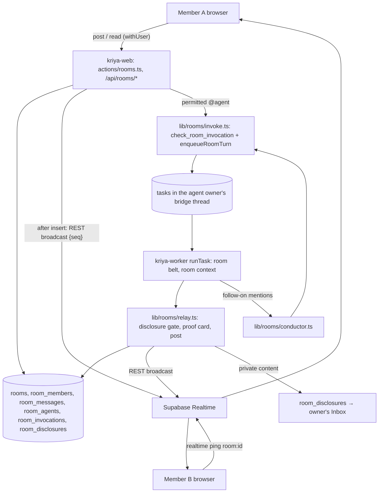

# Architecture (track R: Rooms)

## 1. Picture



## 2. Components

| Component | Path | Runs in | Responsibility |
| --- | --- | --- | --- |
| Data | migration `20270401000000_rooms.sql` | Postgres | Tables, membership functions, `post_room_message`, `join_room`, `check_room_invocation`, realtime policy |
| Person actions | `actions/rooms.ts` | Web | Create, rename, invite, revoke invite, join, leave, remove, post, delete own message, add/remove own agent, set agent policy, share/discard disclosure, stop agents, report (all `withUser` + zod) |
| Reads | `queries/rooms.ts`; `app/api/rooms/[roomId]/messages/route.ts` (GET `?after=seq`) | Web | Room list, room, messages after a seq, members, agents, unread counts |
| Realtime | `lib/rooms/realtime.ts` | Web and worker | REST broadcast ping; no-op when `rooms.realtime` is off or Supabase keys are missing |
| Invocation | `lib/rooms/invoke.ts` | Web (from a post) and worker (conductor) | Parse mentions, policy check (`check_room_invocation`), build the bridge prompt, `enqueueRoomTurn` |
| Bridge prompt | `lib/rooms/context.ts` | Web/worker | The code-written user message: room title, requester, last `rooms.contextMessages` messages quoted as untrusted, confirmed room notes, the request |
| Relay | `lib/rooms/relay.ts`, called from `runTask` settle | Worker | Disclosure gate, proof card from the episode, `post_room_message` as the agent, ping, then the conductor |
| Conductor | `lib/rooms/conductor.ts` | Worker | Follow-on agent turns within the budget (RD-12) |
| Re-check relay | `lib/rooms/recheck.ts`, one `try` block in `schedulerLoop` | Worker | Posts a system line when a room task's run changes delivery status (track N rows) |
| Agent tool | `room_history` in `lib/rooms/tools.ts`, re-exported from `lib/agent/tools.ts` | Worker | More messages of the current room (R0, `FOREIGN`) |
| UI | `app/(workspace)/rooms/**`, `components/rooms/**` | Browser | UX_SPEC |

## 3. A mention, end to end

```mermaid
sequenceDiagram
  participant A as Member A (owner of agent X)
  participant B as Member B
  participant W as kriya-web
  participant DB as Postgres
  participant K as worker (X's owner's task)
  B->>W: post "@X compare these 3 vendors"
  W->>DB: post_room_message (seq 41) ; ping room
  W->>DB: check_room_invocation(room, X, requested_by=B) → allowed (members, under cap)
  W->>DB: enqueueRoomTurn(owner=A, bridge thread of X) + room_invocations row
  W->>DB: system message "X is working" (seq 42) ; ping
  K->>K: runTask: room belt (no private connectors), room context (untrusted)
  K->>DB: reply saved in A's bridge thread; episode written
  K->>DB: relay: no private reads → post agent message + proof card (seq 43) ; ping
  K->>K: conductor: reply mentions @Y? budget left? policy allows B? → maybe invoke Y
  A-->>A: (if private reads) Inbox: "Share X's reply in the room?"
```

## 4. Lines added to `runTask` (track R rows in CHANGE_IMPACT)

1. With `task.input.channel === "room"`: load the room agent row once
   (`allow_connectors`) and pass `{ room: true, connectors }` so the belt
   omits connected-account and app tools unless allowed, and adds
   `room_history`.
2. Capabilities: `...(room && { room: { title } })` → one prompt line
   (RD-07); absent otherwise (byte-identical prompt, RT-REG-01).
3. Settle: after the episode is written, `relayToRoom(task, reply)` (errors
   logged, never fail the task).

Approvals, grants, metering and retries are unchanged: a room task is an
ordinary task of its owner.

## 5. Capacity and cost

| Resource | Bound |
| --- | --- |
| Members, agents per room | `rooms.maxHumans` 25, `rooms.maxAgents` 10 |
| Messages | 30/min per person; body ≤ 8,000 chars |
| Agent turns per human message | `rooms.agentTurnBudget` 4 |
| Agent spend by others | Per-agent daily ₹ cap (SQL) |
| Realtime | One connection per open tab, one channel per open room (REALTIME §4) |
| Database | Messages indexed by `(room_id, seq)`; reads are `seq > n limit 100` |
| Worker | Room tasks are ordinary tasks under each owner's concurrency |
