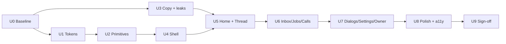

# UI upgrade: implementation plan (track U)

Goal: nobody who signs in should think "AI-generated app". Measured by the exit
checks below, not by taste.

Read first: `AUDIT.md` (what is wrong, with evidence) and `DESIGN_SYSTEM.md`
(the target). Findings are cited as F1–F11.

## Ground rules for agents

AGENTS.md applies in full. In particular:

1. Check `git status` first; preserve uncommitted work. Commit, branch or push
   only when the owner says so. Never push to `origin`.
2. **Visual and copy changes only.** No change to server actions, queries,
   SQL, policies, tools, approvals logic, state machines or what data is shown
   to whom. Information may be *moved* (behind "Details") but never *removed*
   if a rule requires it: costs (invariant 6), "What I did" (track-A rule 7),
   AI disclosure and consent copy (voice rules 8–11), approval consequences.
3. Before editing any file, check it against the allowed-change list in each
   phase below and the other tracks' `CHANGE_IMPACT_AND_SAFETY.md`. Files
   protected there (e.g. voice confirm/approval components) get styling-only
   edits. Keep every string that states a consequence, a cost or a
   disclosure.
4. All local runs use `.env.verify` and pass `npm run verify:guard` (operator
   rule 6). Never point the dev server at the live database.
5. Each phase ends with `npm run check` green and a browser check at 360 and
   1280 px, light and dark, console clean, targets ≥ 44 px. Before/after
   screenshots go in `screenshots/ui-upgrade/<phase>/`, recorded in
   `status.md`.
6. One phase at a time. Claim it on the coordination board in `status.md`.

## Phases

U3 doesn't depend on the tokens, so it can ship first. It removes the worst
problem (F1/F2) quickly.

### U0: Baseline and decisions (no code)

- Capture the current state: every signed-in route at 360/1280 × light/dark
  into `screenshots/ui-upgrade/U0/`. Route list from `app/(workspace)/`.
- Owner decisions to record in `DECISIONS.md` (create it):
  - UD-01 agent avatars: monogram tints **or** mascot poses (assets needed).
  - UD-02 drop Geist (recommended) **or** keep it as the only label face.
  - UD-03 activity panel closed by default for new users.
  - UD-04 status bar slimmed (keep only usage and cost).
  - UD-05 copy glossary in `DESIGN_SYSTEM.md` §8 approved.
- Check the live landing for the "Kriya Bots"/indigo drift (F11). Record what
  you find as fact or as unknown.
- Exit: screenshots committed (on owner approval), decisions answered.

### U1: Tokens

- `app/globals.css`: the type scale (6 tokens), 3 radii, 3 elevations, colour
  roles, motion tokens. Darken `--muted-foreground` to ≥ 4.5:1. Halve the
  `.aura` opacity. Leave the `.glass*` classes in place for now (removed in
  U4–U7 as screens migrate).
- `app/layout.tsx`: drop Geist if UD-02 says so and remap `--font-mono` for
  labels to Inter.
- Add an ESLint rule (`no-restricted-syntax` on className literals, or
  `eslint-plugin-tailwindcss` if already installed; otherwise a small custom
  regex in `eslint.config`) that warns on `text-[`, `rounded-[` and
  `shadow-[` in `components/` and `app/`. It warns now and errors at U9.
- Exit: no visual regressions beyond the intended changes; the lint warning
  count is recorded as the burn-down baseline (about 650 today).

### U2: Primitives

- `components/ui/button.tsx`: variants `primary|secondary|ghost|danger|link`,
  sizes `md|sm|icon` per spec §4. Remove `gel` and the inner-highlight
  shadows. Keep the old variant names as aliases (`default→primary`,
  `outline→secondary`, `destructive→danger`) so nothing breaks.
- New in `components/ui/`: `page-header`, `section`, `card`, `list-row`,
  `status-badge`, `empty-state`, `key-value`, `disclosure`, `switch` (Base UI).
- `components/icons.ts`: the concept→icon map.
- `components/Glyph` → new `Avatar` (per UD-01). Keep the `glyph` seed as the
  input so stored data is unchanged.
- Tests: one render test per primitive (variant classes, 44 px hit area on
  `sm`, the switch's aria state).
- Exit: a `/dev/ui` page (behind `NODE_ENV !== "production"`) shows every
  primitive in both themes.

### U3: Copy and internal leaks (F1, F2, F8)

The most visible fix. It can ship before U1.

- `components/thread/transcript.tsx`: crew and schedule messages render as a
  `Card` titled "Team report" / "Your part of the job" / "Check-in". The
  model-facing instruction text is **not** rendered. Show a structured summary
  instead (per-member status + their result, Markdown rendered, links as
  "Open Ravi's thread" instead of raw paths). The raw text stays available
  under `Disclosure` "Show what was sent to the agent" for transparency.
  Ask the owner whether that disclosure should exist at all.
- Per-message telemetry (`everyday model · 10 in · 5 out · 0.0s`) collapses to
  a hover/tap `Disclosure`. The thread keeps a single human line per turn:
  "4 steps · 6 s · ₹0.02" (cost always visible when priced; "not priced"
  becomes "Cost pending").
- Activity panel: one timeline of steps with human labels (labels already live
  in `components/workbench/activity.tsx`). Model and token details go behind
  "Details".
- Strip `[verify:…]` from titles at render (fixtures only, but harmless).
- Job page schedule card: show "Every Monday at 10:00 — checks progress and
  takes the next allowed step", with the full prompt behind `Disclosure`.
- Apply the glossary (§8) across headings, badges and empty states.
- Exit: grep for person-facing strings containing `mandate_`, `crew_dispatch`,
  `tokens`, `/a/` paths, `verify:` returns nothing. Copy diff reviewed by the
  owner. Safety strings unchanged (diff shows none touched).

Allowed changes for U3 (owner approved 2026-10-23):

| File | Change | Must not change |
| --- | --- | --- |
| `components/thread/crew-message.tsx` (new) | Parse and render crew results/briefs | — |
| `components/thread/transcript.tsx` | Use the crew cards; tier name instead of "x model"; no token counts under replies | Other channels, "Scheduled run" label, memories/skills chips, What I did |
| `app/(workspace)/goals/[goalId]/page.tsx` | Schedule prompt clamped to two lines, expandable | Controls, quotes, caps, job panel |
| `tests/agent/transcript.test.ts` | New render tests | Existing tests |
| `components/thread/tool-call.tsx`, `components/thread/thread-view.tsx` | Touch targets to 44 px (`min-h-11`), class only | Behaviour, other tracks' renderers |
| `scripts/verify-u3-browser.mjs` | Screenshot script for U3 | — |

### U4: App shell

- Sidebar: `ListRow` items, new avatars, "Today" list with real titles, squads
  empty state replaced by a small "Create a team" ghost button.
- "New task": `primary` solid, the same in both themes.
- Status bar per UD-04. Mobile header: `LogoMark` crisp, no smudged mascot.
  Mobile tab bar: glass allowed, 64 px, labels `text-meta`.
- Exit: shell identical in structure; targets ≥ 44 px; screenshots.

### U5: Home and Thread

- Home: keep the greeting and composer (they work). Suggestion chips become
  `secondary` sm buttons with no sheen (this fixes the dark-mode lumps). "Hand
  Kriya a job" uses `ListRow` with distinct icons. "Nothing waiting" becomes an
  `EmptyState` line, not a card.
- Composer: the send button follows the §4 rule; the model tier is a word, not
  a sparkle; the shortcut hint shows only on fine pointers.
- Thread: user bubbles `--radius-lg`, agent messages without a bubble (as
  now), message spacing on the 4 px grid, tool rows (`ToolPart`) as compact
  `ListRow`s.
- Exit: Home and Thread screenshots; no `text-[`/`rounded-[` left in these
  files.

### U6: Inbox, Jobs, Calls (voice files: styling only)

- Inbox: approval card = `Card raised` + `KeyValue` + footer `[Decline]
  [Approve]` (primary on the right), `StatusBadge` for the kind.
- Job page: remove nested cards; `PageHeader` + `StatusBadge` + sections.
  "Done means" checklist as a single list, not duplicated.
- Calls: `PageHeader` with "New call" as primary. "Stop all calls" becomes a
  `danger` ghost in the header overflow, or below the list, still one tap away
  and still confirmed. **Confirm with the owner before moving it**: it is a
  safety control. Contact avatars per §6. Empty state with the mascot.
- Call result: headline once, `Verified` badge, transcript as `ListRow`s.
- Exit: voice and operator screenshots compared with Phase 7 / O7 / O11 ones;
  every consent and disclosure string unchanged.

### U7: Dialogs, forms, settings, owner console

- Dialog footer per §4 everywhere (`components/dialogs/*`, `Confirm`,
  `AlertDialog`).
- Forms: label above field, helper text `text-meta`, errors inline.
- Owner config (F10): group by section with a sticky section nav, a search
  box, `Switch` for on/off keys and one "Save changes" bar per section.
  Server-side validation stays as is (invariant 7).
- Exit: no stacked mismatched buttons anywhere; owner console screenshot.

### U8: Polish and accessibility

- Burn down the remaining lint warnings to zero.
- Focus rings visible on every control; tab order checked on Home, Thread and
  Inbox; `prefers-reduced-motion` respected; contrast checked with axe.
- Loading states: skeletons with fixed heights for lists (no layout shift);
  streaming caret in threads.
- The mascot "working" loop (§9).
- Exit: axe shows no serious/critical issues on the main routes.

### U9: Sign-off

- Turn the lint rule to error.
- A full screenshot sweep (same matrix as U0) side by side in `status.md`.
- The owner reviews with 3–5 people who haven't seen the app: "Does this look
  like a finished product?" Record their answers verbatim (no fabricated
  feedback).
- Exit: owner sign-off recorded.

## Exit checks for the whole track

| Check | How |
| --- | --- |
| No arbitrary sizes/radii/shadows | lint rule at error, 0 violations |
| No internal text in UI | the grep list from U3 returns nothing |
| Touch targets | Playwright script asserts ≥ 44 px on interactive elements at 360 px |
| One primary per view | manual checklist per route in `status.md` |
| Contrast and a11y | axe on main routes, no serious/critical issues |
| Safety copy unchanged | diff of disclosure/consent/approval strings is empty or owner-approved |
| `npm run check` | green |

## Not in scope

New features, a new brand, new fonts beyond the two kept, a component library
swap, an intro/landing redesign (the landing gets a brand-drift check only), and
changes to any data, permission or agent behaviour.
