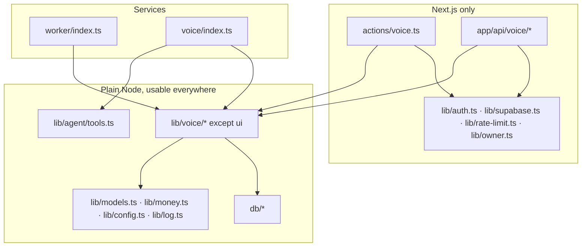

# Change impact and safe execution

What the voice work may touch in the existing product, exactly how, what could
break, and the test that proves it didn't. A coding agent reads this **before
editing any existing file**. If a change isn't listed here, it needs the
owner's approval and a new row in this file first.

Verified against the code at commit `bdf223f` on 2026-10-17. Baseline:
`npm run check` passes (typecheck, lint, format, **82 tests / 9 files**).

## 1. Findings from the re-audit (2026-10-17)

| # | Finding | Severity | Status |
| --- | --- | --- | --- |
| F1 | DATA_MODEL specified `(thread_id, user_id) … on delete set null`. On Postgres that nulls `user_id` too and the delete fails, so the existing **delete thread** action would break for any thread a voice task came from. Proven on PGlite 18.6 | High (would break an existing workflow) | **Fixed in the design**: `on delete set null (thread_id)`, same for `parent_task_id`; caution box in DATA_MODEL |
| F2 | The core rollback (`supabase/rollback/20261016000000_kriya_core.down.sql`) drops the whole `kriya` schema but removes only its own version row; voice versions would stay "applied" and be skipped on re-migrate | Medium (staging resets) | **Fixed in the design**: voice down files run first and delete their own rows |
| F3 | `scripts/migrate.ts` runs each file in a transaction; PGlite runs every migration in tests | Medium | **Rules added** to DATA_MODEL: no `concurrently`, no extensions, hashing in app code |
| F4 | `lib/agent/instructions.ts:87` tells every agent it "can't … send messages"; adding `propose_call` without a matching capability line would make agents contradict their own tools | Medium (agent behaviour) | **Rule added** (§3, row `instructions.ts`) |
| F5 | Adding `propose_call` to every agent's tool belt would change behaviour for people without voice access | Medium | **Rule added**: the tool is included only when the user has voice access and the plan allows it |
| F6 | `worker/index.ts` shares one `running` map and `CONCURRENCY` for all work; a voice loop using it could starve agent tasks or vice versa | Medium | **Rule added**: separate map and `VOICE_CONCURRENCY` |
| F7 | `kriya-voice` runs outside Next.js; importing a module that imports `"server-only"` or `next/*` crashes it at start. Those are `lib/auth.ts`, `lib/owner.ts`, `lib/rate-limit.ts`, `lib/supabase.ts` | Medium | **Rule added** (§4) + test T-IMP-01 |
| F8 | Putting the in-call tools in the `KriyaTools` type would change `KriyaMessage`, the type of every saved message | Medium | **Rule added**: `createCallTools()` is exported separately and never added to `KriyaTools` |
| F9 | Counting voice charges in `usageSummary` changes the allowance check for **agent tasks** too (intended: one allowance) | Low (intended, but a behaviour change) | Called out in §3; test T-COST-05 plus the existing pipeline tests |
| F10 | `npm run check` failed locally: `render.yaml` had CRLF line endings in this Windows checkout (git stores LF, `.gitattributes` says `eol=lf`), and Prettier scanned the local `.serena/` tool folder | Low (local only, blocks every phase's exit check) | **Fixed**: `render.yaml` working copy back to LF (`git diff` empty, content unchanged); `.serena` added to `.prettierignore`. `npm run check` now passes |
| F11 | `.prettierignore` contains `*.md`: `npm run format:check` never checks Markdown | Info | Docs are formatted with an explicit `npx prettier --write <files>` |
| F12 | (Phase 1, 2026-10-20) The voice migrations are named `2026102…` but track A has since added 14 migrations named `20261101…`–`20261114…`. PGlite and `scripts/migrate.ts` handle that (name order on a fresh database; pending-by-set on an existing one), and `npm test` proves every track A migration still applies after the voice core. `supabase db push` refuses a version older than the newest one already applied unless run with `--include-all` | Medium (deploy only) | **Open**: apply with `npm run db:migrate`, or `supabase db push --include-all`, if track A reaches a database first (B2 says nothing has been applied yet) |
| F13 | (Phase 1) The existing track A test "rolls goals, schedules, approvals and episodes back…" counts every `kriya` column named `verification`; DATA_MODEL's `call_attempts.verification` made it fail (13 ≠ 12) | Medium (would have changed an existing test) | **Fixed**: the column is `call_attempts.provider_snapshot`; DATA_MODEL, SECURITY §7 and CONVERSATION §7 updated |
| F14 | (Phase 1) Deleting an account nulls `voice_usage`'s three `set null` keys one at a time, and an immediate FK check on the second update saw the third key still pointing at a deleted attempt (`voice_usage_call_attempt_id_fkey`); proven on PGlite | Medium (account deletion would fail) | **Fixed**: those three FKs are `deferrable initially deferred` (checked at commit; the set-null actions still run at once); T-FK-01 covers it |
| F15 | (Phase 2) The existing release test "the privacy notice names every outside service the code is configured for" (`tests/readiness`) treats every env-name prefix in `lib/env.ts` as an outside service; `EXOTEL_STREAM_SECRET` made it report Exotel, which the privacy notice doesn't (yet) name | Medium (would have changed an existing test or the legal draft) | **Fixed**: the secret Kriya generates for stream Basic auth is `KRIYA_VOICE_STREAM_SECRET` (docs updated). The test will rightly fail in Phase 5 when `EXOTEL_API_KEY` etc. are added, until the privacy notice names Exotel |
| F16 | (Found in Phase 3; Phase 1 defect) With `casing: "snake_case"`, Drizzle maps `ownerPhoneE164` to `owner_phone_e_164`, but the SQL columns are `…_e164`: every Drizzle query on `voice_profiles`, `voice_tasks`, `voice_calls`, `phone_verifications` would have failed. Phase 1's T-DB-02 used its own camel→snake helper and missed it | High (voice tables unusable through Drizzle) | **Fixed**: the four columns are named explicitly in `db/schema.ts`; T-DB-02 now uses Drizzle's own `toSnakeCase` for unnamed columns, so it fails on exactly this |
| F17 | (Phase 3) DATA_MODEL §3 had no edge for three real paths: an authorized task whose outreach window closed before any dial, a call never claimed before its window closed, and a call blocked by the re-check after claiming. `voice_transition()` returned false and the app silently carried on (a blocked call was then retried) | High (suppressed number retried) | **Fixed**: edges `task authorized → failed`, `call scheduled → exhausted`, `call dialing → blocked` in `20261021000000_voice_queue.sql`; the app's `transition()` now throws when an edge it chose doesn't apply (webhooks opt out: out-of-order is normal there) |

| F18 | (Phase 4) AGENTS.md voice rule 9 and D-14 put `createCallTools()` in `lib/agent/tools.ts`, run by `kriya-voice`; Phase 2's boundaries test says `kriya-voice` loads nothing of `lib/agent/`, and importing `tools.ts` would load `lib/secrets.ts` and `lib/connectors.ts` into the voice process | Medium (wider code in the voice process than the design intends) | **Decided by the owner (2026-10-20)**: `lib/agent/call-tools.ts` (only `ai` + `zod`), re-exported from `tools.ts`; AGENTS.md rule 9 and D-14 updated; T-IMP-01 checks `lib/voice/session.ts` loads `call-tools.ts` and nothing else of the agent, and no secrets/connectors code |
| F19 | (Phase 4) zod 4 throws on `.omit()` of an object with a `.refine()` ("cannot be used on object schemas containing refinements"). `propose_call` built from `draftInputSchema.omit(…)` made **every agent task of a user with voice access fail at start**; caught by T-AGT-01 | High (agent tasks broken for voice users) | **Fixed**: `lib/voice/schemas.ts` exports `draftFieldsSchema` and `acceptableTimesRule`; `draftInputSchema` validates exactly as before |
| F20 | (Phase 4) A false agreement: "Friday works better for me" holds the lexicon word "works", so the agreement guard took it as a yes to Wednesday 3 PM. Found by an S08 phrasing variant on the scripted model | High (O2, a false "agreed") | **Fixed**: a yes that names another day or time is never a confirmation, in the guard and in `confirm_details` (it's a correction). Covered by S08's variants |
| F21 | (Phase 4) `voice_tasks.result` has no `callback_requested`, which CONVERSATION §6 allows in an outcome | Low | **Mapped**: the outcome keeps `callback_requested`; the task's result is `unclear`. A migration can add the value if the UI needs it |
| F22 | (Phase 4) Two Phase 3 paths couldn't handle a connected call: `verifyAttempt` returned early on any terminal attempt, so one ended by `kriya-voice` was never verified; and `settleCall` would have tried `in_call → retry_wait`, an edge that doesn't exist (it would throw) | High (connected calls never settle) | **Fixed**: verification skips only attempts already verified; an `in_call` call settles (or is cancelled) only from a finished outcome; a dialing call whose attempt connected moves to `in_call` first, so a third party who spoke to Tavi is never redialled |
| F23 | (Phase 4) Deviation from CONVERSATION §7: outcome extraction runs in `kriya-voice` when the stream ends (and in worker recovery for a lost stream), not inside the provider's webhook request, where a model call would slow the provider's retry clock | Info | Recorded; the deterministic checks and settling are shared (`finishOutcome`, `settleCall`) and run in whichever order the stream end and the provider's final status arrive |

| F24 | (Phase 7) An automated review flagged `createDraft` storing a `threadId` from the browser unchecked. Not an IDOR: `voice_tasks (thread_id, user_id)` references `threads (id, user_id)`, so another person's thread fails the insert. But that failure surfaces as a server error, not `invalid` | Low (error message only) | **Open**: check the thread's owner in `createDraft` and answer `invalid`, when drafts get field editing (`updateDraft`) |
| F25 | (Phase 7 session 2, automated review of commit `94de49d`) `voice_access.test_numbers_only` (default true) is read nowhere: `voicePlan` checks only that the row exists, so `createDraft`/`confirmCall`/`prepareAttempt` accept any Indian mobile | High once live (not exploitable now: no live provider, the worker doesn't dial) | **Open**: Phase 5 must enforce it (fail closed without a configured list) before the first live call |
| F26 | (same review) The per-user and per-number limits in `confirmCall` lock only the task row, so two different tasks confirmed at the same moment can both pass the count | Medium (limit exceeded by concurrent confirms) | **Open**: per-user advisory lock (`pg_advisory_xact_lock`) before counting; Phase 5 or 8 |
| F27 | (same review) `handleStatusWebhook` trusts the body's `providerCallId` while `attempt.providerCallId` is still null and passes it to `verifyAttempt` | Medium (needs the per-attempt callback secret) | **Open**: ignore final statuses until the worker has recorded the call id, never pass the body's id; Phase 5 |
| F28 | (Phase 7 session 2) `.env.local` sets `NEXT_PUBLIC_SUPABASE_URL` to a placeholder (`dummy-project`), which overrides `.env`; locally, Auth and the database (`kriya-tavi`) are different projects, so nobody can sign in | Medium (local only) | **Open (owner)**: point `.env.local` at the same project as `DATABASE_URL`, or remove the two `NEXT_PUBLIC_SUPABASE_*` lines there |
| F29 | (Phase 7 session 2) The Home "Phone calls" row is inside the `hasAgents` branch, so a voice user with no agents has no Home entry (the palette entry works) | Low | **Fixed** (session 3): one `callsLink` rendered in both branches; checked in the browser |
| F30 | (Phase 7 session 4, mock call on staging) `prepareAttempt` (`lib/voice/run-call.ts`) bound a JS `Date` in a raw `sql` template (per-number daily count). PGlite accepts it; postgres-js on real Postgres throws `ERR_INVALID_ARG_TYPE`, so every outreach call would fail before dialling | High (no outreach call could be placed) | **Fixed** (prerequisite for Phase 7 acceptance): `${dayStart(now).toISOString()}::timestamptz`, the repo's idiom (`lib/browser/profiles.ts`); the only `Date` among the voice code's raw `sql` parameters. No regression test possible on PGlite; the staging run is the check |
| F31 | (same run) `DATABASE_URL` in `.env` uses Supabase's session pooler (port 5432, 15 clients). `db/index.ts` expects the transaction pooler (6543) and opens up to 10 per process, so the web app plus one worker or script exhausts it (`EMAXCONNSESSION`, HTTP 500 on `/calls`) | High for deploy (local: intermittent 500s) | **Open (owner)**: point `DATABASE_URL` at the 6543 transaction pooler; keep 5432 only for `MIGRATION_DATABASE_URL` |
| F32 | (Phase 6) §4 rule 3 says `kriya-voice` reads a task only through `loadAttemptContext(attemptId)`. An owner call needs two more reads: `loadVerificationContext(attemptId, userId)` (the verification call, which has no task) and `loadReportContext(taskId, userId)` (the same task's outreach attempts and the connected attempt's outcome, for the report script). Both are in `lib/voice/run-call.ts`, filter every table by id **and** `user_id`, and the report loader takes the task id from the attempt `loadAttemptContext` already loaded, never from the caller | Low (same scope as rule 3, one more loader) | **Open (owner)**: accept rule 3 as "through the loaders in `run-call.ts`, each scoped by id and `user_id`", or ask for the report facts to be folded into `loadAttemptContext` |
| F33 | (automated security review of `2addc76`) A verification call goes to whatever number is typed in, which may be a stranger's. It skipped suppression and every per-number cap; only the per-account (5/hour) and per-address limits applied, so several accounts could ring one number repeatedly | Medium (harassment by verification calls) | **Fixed** (Phase 7 session 5): `startPhoneVerification` refuses a suppressed number and caps verifications at 3 per number per 24 h across all accounts (database clock, an advisory lock per number so two accounts can't both pass the count); dialling re-checks suppression. Test in `reminders.test.ts`. **Open (owner)**: verification calls still ignore calling hours (VOICE_REMINDERS: "the owner started it and is waiting on screen"); restrict them to calling hours if a stranger's number at night matters more |


## 2. Never touch without the owner's explicit approval

These carry the existing product. The voice work doesn't need to change them.

| Path | Why it's protected |
| --- | --- |
| `supabase/migrations/20261016000000_kriya_core.sql`, `…17…_connections.sql`, `…18…_brand.sql` | Applied migrations are immutable (AGENTS.md invariant 2) |
| `kriya.tasks`, `claim_task`, `heartbeat_task`, `recover_tasks` | Agent queue semantics, proven by `tests/db/queue.test.ts` |
| `lib/agent/queue.ts`, `lib/agent/run-task.ts` (except the rows in §3) | Agent turns, approvals, streaming |
| `lib/agent/metering.ts`, `kriya.usage_events`, `kriya.charges` | Agent metering; voice gets its own tables |
| `lib/billing.ts`, `app/api/billing/webhook/route.ts` | Payments |
| `lib/secrets.ts`, `lib/connectors.ts`, `kriya.connections` | Token encryption |
| `app/api/events/route.ts`, `components/workspace/notifier.tsx` | Notifications; D-07 keeps voice out of them |
| `lib/auth.ts`, `lib/supabase.ts` | Identity |
| `db/index.ts` (`withUser`, `privileged`) | Tenancy |
| `.github/`, `LICENSE`, `NOTICE.md` (except attribution rows for ported code) | Repo governance |

## 3. Existing files that change, and how

Each row: the only change allowed, the risk, and the test that must pass.

| File | Phase | Allowed change | Risk | Proof |
| --- | --- | --- | --- | --- |
| `db/schema.ts` | 1 | **Add** table definitions and the new `plans` columns; don't edit existing ones | Type drift from SQL | `npm run typecheck`; T-DB-02 compares columns with the migration |
| `kriya.plans` (by new migration) | 1 | Add columns with defaults that mean "voice off" | Owner plan form | `actions/owner.ts` updates named fields only (checked), so it's unaffected; existing tests pass |
| `tests/db/migrations.test.ts` | 1 | Add a voice down/up case; keep existing cases | — | Itself |
| `lib/log.ts` | 1 | Add a phone-number pattern to value redaction | Over-redaction of other digits (amounts, ids) | T-LOG-01 incl. negative cases: `₹1,20,000`, UUIDs, timestamps unchanged |
| `lib/entitlements.ts` | 1, 8 | Phase 1: types only. Phase 8: `usageSummary` adds voice charges; new `checkVoiceAllowed()` | F9 | T-COST-05 + `tests/pipeline.test.ts` unchanged and passing |
| `lib/config.ts` | 2 | Add `voice.*` to `SETTINGS`, voice keys to `SECRETS` | `/owner/config` lists every setting: patterns needed | T-CFG-01: each new setting has a pattern or is documented free text |
| `lib/env.ts` | 2 | Add a `"voice"` service to `REQUIRED`/`OPTIONAL`; voice keys optional for `worker` | A required key would stop the worker starting | Worker still starts with no voice variables (T-ENV-01) |
| `package.json` | 2 | Add `ws` (after review), scripts `voice`, `dev:voice`, `voice:eval` | Dependency risk | Review recorded in `status.md`; `npm ci` + build |
| `render.yaml` | 2 | Add the `kriya-voice` service; worker env vars | A Blueprint sync could ask for new secrets on existing services | New keys only on the new service and as optional on the worker; existing keys untouched |
| `proxy.ts` | 3, 7 | Add `/api/voice/exotel/` to `WEBHOOKS`; `/api/voice/tasks` to `PROTECTED_API`; `/calls` to `PROTECTED` | Webhook exemption too broad | T-WH-04: other POSTs still refused; exact prefix only |
| `worker/index.ts` | 3 | Second loop behind `KRIYA_VOICE_ENABLED=1` with its **own** running map and `VOICE_CONCURRENCY` (F6); call `recover_voice_calls()` on its own timer | Starving agent tasks; crash taking the agent loop down | Voice loop errors caught and logged like the existing loop; T-WRK-01: agent tasks still claimed while voice calls are dialing; existing queue tests pass |
| `lib/agent/tools.ts` | 4 | Add `createProposeCallTool()` (thread) and a separately exported `createCallTools()` (in-call). `KriyaTools` gains **only** `propose_call`; the call tools are never added to it (F8) | Message type change; agents calling the tool unasked | Typecheck; T-AGT-01: tool absent without voice access (F5) |
| `lib/agent/run-task.ts` | 4 | One line: include `createProposeCallTool(env)` when `voiceAvailable` (computed in `loadContext`) | Behaviour change for everyone | T-AGT-01; existing pipeline tests pass |
| `lib/agent/instructions.ts` | 4 | Add a capability line only when voice is available: "You can draft a phone call with `propose_call`; the person confirms it in Kriya before anyone is called. You can't place calls yourself." Keep line 87 as is for everyone else (F4) | Prompt drift | T-AGT-02 snapshot of instructions with and without voice |
| `components/thread/tool-call.tsx` | 4 | Add a `case "propose_call"` rendering a link card | None (default case exists) | Typecheck, lint |
| `components/workbench/activity.tsx` | 4 | Add `propose_call` to `TOOL_LABELS` | None | Lint |
| `app/(workspace)/account/page.tsx` | 7 | Add a "Phone & calls" section component, shown only with voice access | Layout regression | T-UI-02 at 360 px |
| `components/workspace/bottom-nav.tsx` / Home | 7 | Entry to `/calls` only with voice access | Nav overflow at 360 px | T-UI-02 |
| `app/owner/*`, `lib/owner.ts` | 8 | Add voice sections; never select transcript text | Owner privacy rule | T-OWN-01 |
| `lib/money.ts` | 8 | Add `toMicroInr`; don't change existing functions | Rounding | `tests/money.test.ts` existing cases unchanged + new |
| `.prettierignore` | 0 | `.serena` (done) | — | `npm run format:check` |
| `AGENTS.md` | 0 | Voice section (done) | — | — |

Everything else in the voice plan is a **new** file under `lib/voice/`,
`voice/`, `app/(workspace)/calls/`, `app/api/voice/`, `components/voice/`,
`actions/voice.ts`, `queries/voice.ts`, `tests/voice/`, `tests/db/voice-*`,
`supabase/migrations/2026102*`, `supabase/rollback/2026102*`, `scripts/voice-eval.ts`.

## 4. Module boundaries



Rules:

1. `lib/voice/**`, `voice/**` and anything they import must not import
   `"server-only"`, `next/*`, `lib/auth.ts`, `lib/supabase.ts`,
   `lib/rate-limit.ts` or `lib/owner.ts` (F7). Test **T-IMP-01** walks the
   import graph from `voice/index.ts` and `worker/index.ts` and fails on any of
   them.
2. Client components (`components/voice/*`) import types and `lib/tiers.ts`-style
   client-safe modules only, never `db`, `lib/config`, `lib/models`, `lib/voice/*`
   server modules (AGENTS.md convention).
3. `kriya-voice` reads a task only through `loadAttemptContext(attemptId)` in
   `lib/voice/run-call.ts`, which selects the attempt, call and task by id **and**
   `user_id`, and nothing else (T-SEC-05).

## 5. Execution protocol for a coding agent

Before the first edit of a session:

```bash
git status --short          # stop if there are changes you didn't make; ask
git log --oneline -3        # confirm the commit status.md expects
npm run check               # must pass before you start; if not, stop and report
```

During the phase:

- Edit only files listed for the phase in `status.md` or in §3 here.
- New migration: write it, run `npm test` (PGlite applies it), then the
  rollback test. Never connect to a real database unless the owner asks.
- After each logical step: `npm run typecheck && npm test`.
- No real call, model, STT or TTS request in tests (scripted mocks only).

Stop and ask the owner when:

- a needed change touches a file in §2 or one not in §3;
- an existing test fails and the fix isn't obviously in your own change;
- a provider's behaviour differs from these documents;
- you'd need a secret, an account or money.

At the end:

```bash
npm run check               # paste the summary lines into status.md
npm run build               # for phases that touch app/ or services
git status --short          # list every changed file in status.md
```

Then update the phase in `status.md`: files changed, commands and real output,
blockers, next exact action. Don't mark `COMPLETE` with any check failing.

## 6. Production-readiness gates

No document can guarantee "100 %". Kriya instead refuses to go live until each
gate has evidence recorded in `status.md`:

| Gate | Evidence |
| --- | --- |
| G-A Existing product unharmed | `npm run check` and `npm run build` pass after every phase; the pre-voice tests pass unchanged |
| G-B Data safety | Migration + rollback tested on PGlite and on a staging Supabase project; RLS tests for every table |
| G-C No duplicate or unauthorized calls | D1 = 0 and S1 = 0 on the fault-injection suite (EVALUATION_PLAN §4) |
| G-D Truthful outcomes | O2 = 0 with its stated bound; T-VER-01…08 pass |
| G-E Reminder correctness | R1 = 100 % on the suite and on live owner calls |
| G-F Compliance | Counsel's written answers to Q1–Q10; A2P declaration done |
| G-G Operations | Emergency stop rehearsed; deploy during a live call rehearsed; alerts firing in staging |
| G-H Review | Independent code and security review with no open critical items |
