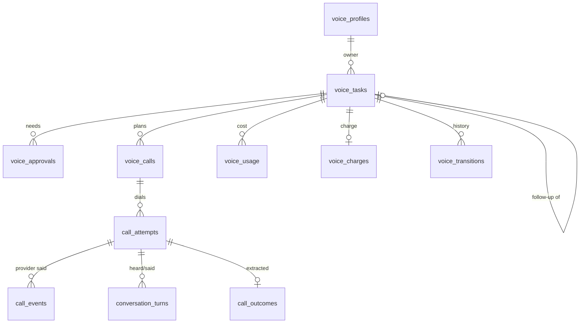
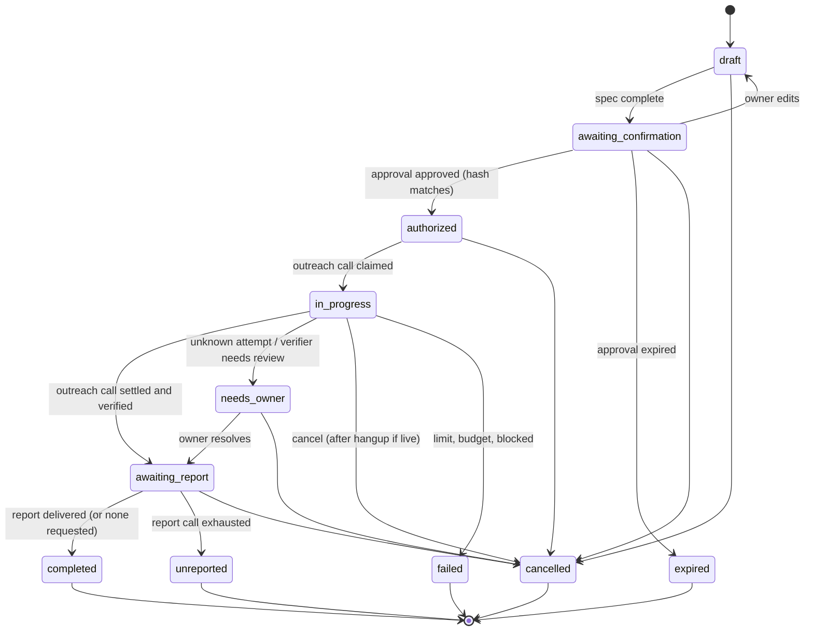
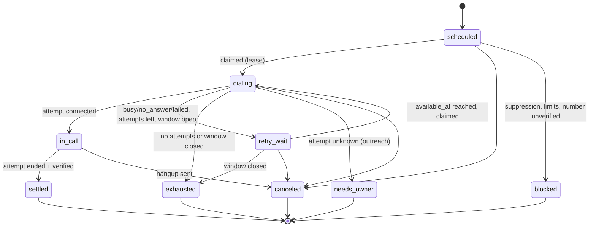
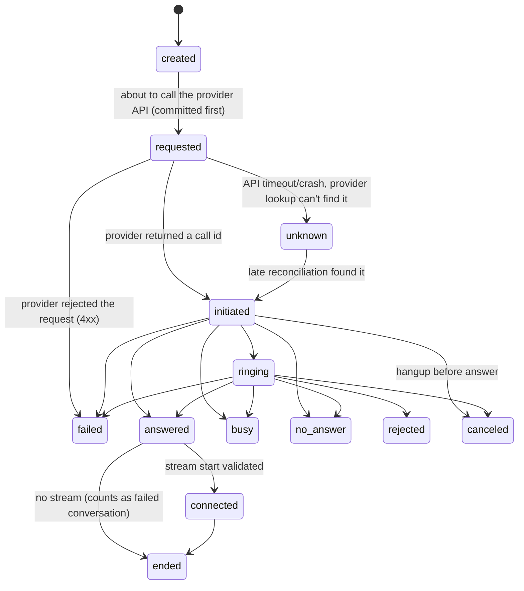

# Data model and state machines

Supabase Postgres is the only source of truth (D-05, D-06). Nothing about a
call or reminder lives only in memory, on a disk or in the browser. This is the
specification for the Phase 1 migration
`supabase/migrations/20261020000000_voice_core.sql`; the SQL below is a sketch,
and the migration is authoritative once written. `db/schema.ts` mirrors it.

Conventions from the existing schema apply: everything in schema `kriya`; RLS
enabled on every table; `user_id uuid not null`; composite keys `(id, user_id)`
so child rows can't point at another user's parent; `timestamptz` everywhere;
money as `bigint` micro-units; `touch_updated_at` triggers.

> [!CAUTION]
> **Composite foreign keys with `on delete set null` must name the column:**
> `foreign key (thread_id, user_id) references kriya.threads (id, user_id) on
> delete set null (thread_id)`. A plain `on delete set null` nulls _both_
> columns; `user_id` is `not null`, so the parent's delete fails. Proven on
> PGlite 18.6 on 2026-10-17: `null value in column "user_id" … violates not-null
> constraint`. With the plain form, the existing **delete thread** action
> (`actions/threads.ts` `deleteThread`) would start failing for any thread a
> voice task came from. The column-list form needs Postgres ≥ 15: Phase 1 checks
> `show server_version` on the Supabase project first.

**Migration rules** (from how `scripts/migrate.ts` and the test harness work):

- Each file runs in one transaction (`sql.begin`), so no
  `create index concurrently`, no `vacuum`, nothing that can't run in a
  transaction.
- It must run unchanged on PGlite (`tests/db/harness.ts` applies every file in
  `supabase/migrations/` in order): no extensions (`pgcrypto`, `pg_cron`,
  `pgsodium`), so hashing and HMAC happen in application code; no
  Supabase-only roles beyond `anon`, `authenticated`, `service_role` and the
  `auth` shim.
- Functions follow the core migration's style: `security definer set
  search_path = ''`, fully qualified names, `revoke all … from public`.
- Status-guard triggers fire only when `new.status is distinct from
  old.status`, so cascaded `set null` updates and timestamp updates pass.
- Rollback order: `voice_core.down.sql` before `kriya_core.down.sql`. The
  core rollback drops the whole `kriya` schema but deletes only its own
  `schema_migrations` row; if run alone, the voice versions would stay
  recorded as applied and `npm run db:migrate` would skip them. Each voice
  down file deletes its own version row.
- Never edit an applied migration; add a new one.

## 1. Entities

| Table | Purpose | User can | Written by |
| --- | --- | --- | --- |
| `voice_access` | Allow-list for voice (D-12) | — | Owner console |
| `voice_profiles` | Owner's verified number, timezone, quiet hours, retry and retention preferences | select; update preference columns | Server actions; verification flow |
| `phone_verifications` | One-time codes for owner number verification (D-13) | — | Server |
| `voice_tasks` | The owner's request: who, what, authority, report time, state | select | Server (`lib/voice/tasks.ts`), worker, verifier |
| `voice_approvals` | An exact snapshot the owner approved or declined | select | Server actions |
| `voice_calls` | One planned call (outreach, owner report, verification) with schedule, retries and lease | select | Server, worker |
| `call_attempts` | One dial: provider call id, lifecycle timestamps, tokens (hashed) | select (tokens not granted) | Worker, voice service, webhook |
| `call_events` | Raw provider events, deduplicated | select | Webhook, voice service, verifier |
| `conversation_turns` | What each side said (STT text / TTS text) | select, delete (D-10) | Voice service |
| `call_outcomes` | Structured outcome: observations vs interpretations, verifier verdict | select | Voice service, verifier |
| `voice_transitions` | Append-only audit of every state change, with actor and evidence | select | Only `kriya.voice_transition()` |
| `voice_usage` | One row per billable unit of work (telephony, STT, TTS, LLM) | select | Worker, voice service, reconciliation |
| `voice_charges` | One charge per voice task | select | Worker |
| `voice_prices` | Owner-entered price sheet with sources | — | Owner console |
| `voice_allowed_transitions` | Static allow-list for `voice_transition()` | — | Migration only |
| `call_suppressions` | Numbers that must never be called (recipient opt-out, abuse) | — | Server |

Mapping from the brief's list: _transcription segments_ are the final STT
results inside `conversation_turns` (no separate table until needed);
_follow-up plans_ are child `voice_tasks` (`parent_task_id`) plus the
`next_action` in an outcome; _owner reminders_ are `voice_calls` with
`kind = 'owner_report'`; _task execution evidence_ is `call_events` +
`voice_transitions.evidence` + `call_attempts.provider_snapshot`; _audit events_ are
`voice_transitions` (state) and the existing `kriya.audit_events` (owner-console
actions); _provider and model references_ are columns on `call_attempts`
(`telephony_provider`, `stt_provider`, `tts_provider`, `tts_voice`,
`llm_model`) resolved from `SETTINGS` at dial time.

## 2. Tables

Column lists are complete for the MVP; `created_at`/`updated_at` omitted where
obvious.

### voice_access

`user_id uuid pk → auth.users on delete cascade`, `granted_by uuid`,
`test_numbers_only boolean not null default true`, `created_at`.

### voice_profiles

| Column | Type | Notes |
| --- | --- | --- |
| `user_id` | uuid pk → auth.users cascade | |
| `owner_phone_e164` | text, `check (owner_phone_e164 ~ '^\+[1-9][0-9]{7,14}$')` | Set only by the verification flow |
| `owner_phone_verified_at` | timestamptz | Null = not verified; no owner calls allowed |
| `timezone` | text not null default `'Asia/Kolkata'` | IANA name, validated in the action |
| `language` | text not null default `'en-IN'` | D-11 |
| `quiet_start`, `quiet_end` | time not null default `'21:30'`, `'08:00'` | Owner calls never start inside |
| `report_mode` | text not null default `'scheduled'` check in (`scheduled`, `on_completion`) | VOICE_REMINDERS.md §5 |
| `report_max_attempts` | int not null default 3 check 1–5 | |
| `report_retry_minutes` | int not null default 10 check 5–120 | |
| `transcript_retention_days` | int not null default 30 check 0–365 | 0 = keep outcome only |

Grants: `select` to authenticated; `update (timezone, language, quiet_start,
quiet_end, report_mode, report_max_attempts, report_retry_minutes,
transcript_retention_days)` to authenticated. Policy `own_rows` on `user_id`.

### phone_verifications

`id uuid pk`, `user_id`, `phone_e164`, `code_hash text` (HMAC-SHA256 with
`KRIYA_PHONE_HASH_KEY`), `tries int default 0 check ≤ 3`, `expires_at`,
`verified_at`, `voice_call_id uuid` (the verification call). No grants.

### voice_tasks

| Column | Type | Notes |
| --- | --- | --- |
| `id` | uuid pk | `unique (id, user_id)` |
| `user_id` | uuid not null | |
| `parent_task_id` | uuid | Follow-up of; `(parent_task_id, user_id)` FK **`on delete set null (parent_task_id)`** |
| `thread_id` | text | Where it was asked, if from a thread; `(thread_id, user_id)` FK **`on delete set null (thread_id)`** — see the warning below |
| `status` | text not null default `'draft'` | §3.1 |
| `result` | text | §3.1: set only with `completed`/`unreported` |
| `language` | text not null default `'en-IN'` | |
| `recipient_label` | text not null check ≤ 80 | "my CA" — description, not identity |
| `recipient_name` | text check ≤ 80 | Only if the owner gave one |
| `recipient_phone_e164` | text not null, E.164 check | |
| `recipient_phone_hash` | text not null | HMAC, for suppression and per-number limits |
| `purpose` | text not null check ≤ 600 | Owner's words, edited and confirmed |
| `spec` | jsonb not null | Structured objective and authority (CONVERSATION_AND_VERIFICATION.md §2); validated by zod before insert |
| `spec_version` | int not null default 1 | |
| `report_at` | timestamptz | Null = no scheduled report |
| `report_requested` | boolean not null default true | |
| `plan_id` | text not null | Limits at creation |
| `max_call_seconds` | int not null | From plan |
| `cost_budget_micro_inr` | bigint not null check > 0 | From plan |
| `approval_id` | uuid | The approval that authorized it |
| `cancel_requested_at` | timestamptz | |
| `idempotency_key` | text check ≤ 128 | `unique (user_id, idempotency_key)` |
| `error_code`, `error` | text | Human-readable, no provider internals |
| `authorized_at`, `finished_at` | timestamptz | |

Indexes: `(user_id, created_at desc)`, `(status) where status not in
('completed','unreported','failed','cancelled','expired')`.

### voice_approvals

| Column | Type | Notes |
| --- | --- | --- |
| `id` | uuid pk | |
| `user_id`, `voice_task_id` | | composite FK |
| `kind` | text check in (`outreach_call`, `follow_up_call`, `scope_change`) | |
| `payload` | jsonb not null | Exactly what the owner sees: number, recipient, purpose, authority, report time, calling window |
| `payload_hash` | text not null | SHA-256 of canonical JSON; the approve action must send it back and it must match |
| `status` | text check in (`pending`, `approved`, `declined`, `expired`, `superseded`) | |
| `expires_at` | timestamptz not null | Default now + 30 min |
| `decided_at` | timestamptz | |

`unique (voice_task_id) where status = 'pending'`: one open approval per task.

### voice_calls

| Column | Type | Notes |
| --- | --- | --- |
| `id` | uuid pk | |
| `user_id`, `voice_task_id` | | composite FK, cascade |
| `kind` | text check in (`outreach`, `owner_report`, `verification`) | |
| `seq` | int not null | `unique (voice_task_id, kind, seq)` — the idempotency key |
| `to_phone_e164` | text not null | Owner number for `owner_report`/`verification` (copied at scheduling, re-checked at dial) |
| `status` | text not null default `'scheduled'` | §3.2 |
| `not_before` | timestamptz not null | Earliest start (e.g. report time) |
| `window_end` | timestamptz | Latest start; after it the call is `exhausted` |
| `available_at` | timestamptz not null | Next claimable time (retries) |
| `attempts` / `max_attempts` | int / int check 1–5 | |
| `lease_owner`, `lease_expires_at`, `heartbeat_at` | | Same semantics as `kriya.tasks` |
| `cancel_requested_at` | timestamptz | |
| `delivered_at`, `acknowledged_at` | timestamptz | Owner reports only (D-08) |
| `last_error_code` | text | |

Indexes: `(available_at) where status in ('scheduled','retry_wait')`;
`(user_id, created_at desc)`.

### call_attempts

| Column | Type | Notes |
| --- | --- | --- |
| `id` | uuid pk | Sent to the provider as `CustomField` |
| `user_id`, `voice_call_id` | | composite FK |
| `attempt` | int not null | `unique (voice_call_id, attempt)` |
| `status` | text not null default `'created'` | §3.3 |
| `telephony_provider`, `stt_provider`, `tts_provider`, `tts_voice`, `llm_model` | text | Provenance |
| `provider_call_id` | text | `unique (telephony_provider, provider_call_id)` |
| `callback_token_hash`, `stream_token_hash` | text not null | SHA-256 of random 32 bytes; **not granted** to authenticated |
| `stream_token_used_at` | timestamptz | One use |
| `stream_owner`, `stream_heartbeat_at` | text, timestamptz | Which `kriya-voice` instance holds the media |
| `requested_at`, `initiated_at`, `ringing_at`, `answered_at`, `connected_at`, `ended_at` | timestamptz | Each set once |
| `end_reason` | text | `callee_hangup`, `tavi_hangup`, `max_duration`, `voice_lost`, `provider` … |
| `billable_seconds` | int | From the provider; null = not reported |
| `last_report_mark_at` | timestamptz | Owner reports: mark of the final chunk (D-08) |
| `verified_at` | timestamptz | After `getCall()` reconciliation |
| `provider_snapshot` | jsonb | Normalized provider snapshot (redacted). Not `verification`: an existing track A test counts every `kriya` column of that name (F13) |

Column grants to authenticated exclude the two token hashes and `stream_owner`.

### call_events

`id bigserial pk`, `user_id uuid` (nullable until correlated),
`call_attempt_id uuid`, `provider text`, `source text check in ('status_webhook',
'stream', 'verify')`, `dedupe_key text not null`, `status text`, `occurred_at`,
`received_at default now()`, `payload jsonb` (redacted: numbers masked to last
4 digits). `unique (provider, dedupe_key)`. Index `(call_attempt_id,
received_at)`.

### conversation_turns

`id bigserial pk`, `user_id`, `call_attempt_id`, `seq int`, `speaker text check in
('tavi','callee','owner')`, `text text check ≤ 4000`, `start_ms`, `end_ms`
(relative to `connected_at`), `stt_confidence numeric(4,3)` (null if not
given), `interrupted boolean default false` (Tavi's speech cut by barge-in),
`played_ms int` (how much of Tavi's turn was actually played, from marks).
`unique (call_attempt_id, seq)`. Grants: select, delete to authenticated.

### call_outcomes

`id uuid pk`, `user_id`, `call_attempt_id uuid unique`, `voice_task_id`,
`schema_version int`, `observed jsonb not null` (from the provider and the
media stream only), `interpreted jsonb` (model-extracted, may be null when
nothing was said), `extraction_model text`, `verifier_status text check in
('pending','accepted','needs_review','rejected')`, `verifier_notes text`. The
JSON shapes are in CONVERSATION_AND_VERIFICATION.md §6.

### voice_transitions

`id bigserial pk`, `user_id`, `entity text check in ('task','call','attempt')`,
`entity_id uuid`, `from_status`, `to_status`, `actor text check in ('owner',
'worker','voice','webhook','verifier','janitor')`, `evidence jsonb`,
`created_at`. Append-only: no update/delete grants to anyone except account
deletion cascade.

### voice_usage, voice_charges, voice_prices

Defined in COST_AND_METERING.md §2–3.

### call_suppressions

`phone_hash text pk`, `reason text check in ('recipient_opt_out',
'abuse_report','owner_block')`, `source_attempt_id uuid`, `created_at`.
Cross-tenant, **no grants**, no `user_id` (so one tenant can't learn another's
contacts). Checked at confirmation and again at dial time.

### Plan columns added to `kriya.plans`

`voice_enabled boolean default false`, `max_outreach_calls_per_day int default 0`,
`max_call_seconds int default 300`, `max_attempts_per_call int default 2 check
1–5` (outreach calls; owner reports use `voice_profiles.report_max_attempts`),
`max_voice_task_cost_micro_inr bigint default 0`. Defaults of 0 mean voice is
off on that plan until the owner sets values in `/owner` (recommended launch
values: SECURITY_AND_COMPLIANCE.md §5). Paid plans stay inactive until the
owner sets them (existing rule: no invented prices).

## 3. State machines

All status changes go through
`kriya.voice_transition(p_entity, p_id, p_to, p_actor, p_evidence)` (D-06):

1. Locks the row (`for update`).
2. Looks up `(entity, from, to)` in `kriya.voice_allowed_transitions`, which
   also lists the actors allowed and the evidence keys required.
3. If the edge is missing, returns `false` and records nothing (an out-of-order
   or duplicate event is not an error). If the actor or evidence is wrong, it
   raises.
4. Sets `kriya.transition = 'on'` locally, updates `status` and the matching
   timestamp, appends `voice_transitions`.

A `before update` trigger on each of the three tables raises if `status`
changes while `current_setting('kriya.transition', true)` isn't `'on'`. Users
have no update grant on these tables at all. **The model is never an actor**:
nothing the LLM outputs is passed as `p_to`; code maps verified facts to
transitions.

### 3.1 Voice task

| Brief's state | Here |
| --- | --- |
| draft, awaiting_confirmation, authorized, completed, failed, cancelled | Same |
| queued, running, awaiting_call, calling, awaiting_response | `in_progress`, with detail from `voice_calls`/`call_attempts` (not duplicated on the task) |
| follow_up_scheduled | A child task in `draft`/`awaiting_confirmation` (D-09) |
| awaiting_owner_reminder | `awaiting_report` |
| — (new) | `needs_owner`, `unreported`, `expired` |

**Status vs result.** `completed` means the procedure finished and the owner was
told; it does **not** mean the callee agreed. `result` is set with the terminal
transition from the accepted outcome: `agreed`, `alternative_proposed`,
`declined`, `no_answer`, `busy`, `wrong_person`, `unclear`, `call_failed`.

Evidence required:

| Edge | Actor | Evidence |
| --- | --- | --- |
| `awaiting_confirmation → authorized` | owner | `approval_id`, `payload_hash` |
| `in_progress → awaiting_report` | verifier | `attempt_id` of the last attempt, `verified_at`, outcome `verifier_status` ∈ (`accepted`) or call `exhausted` |
| `awaiting_report → completed` | verifier | report `voice_call_id` with `delivered_at`, or `report_requested = false` |
| `awaiting_report → unreported` | worker | report call `exhausted` |
| `* → cancelled` | owner or worker (deadline) | `cancel_requested_at`; if a call was live, its attempt `ended` |

### 3.2 Voice call (a planned call and its retries)

For an owner report, `settled` with `delivered_at` null (the owner hung up
mid-report) returns to `retry_wait` if attempts and window remain
(VOICE_REMINDERS.md §4).

### 3.3 Call attempt (provider semantics)

Terminal: `ended`, `busy`, `no_answer`, `rejected`, `failed`, `canceled`,
`unknown`. Exotel reports `busy`, `no-answer`, `failed`, `completed`; it has no
separate `rejected` in the docs read, so a declined call usually arrives as
`busy` — `rejected` stays for providers that report it. The brief's `unknown`
is kept for the one case that matters: we may have rung someone and can't
prove it.

**Ordering.** Webhooks and stream events arrive out of order or twice. Each
status has a rank (`created` 0 … `connected` 6, terminals 9). An event for a
lower or equal rank is stored in `call_events` and ignored for state. Skipping
forward is allowed only along the edges above (`initiated → answered` when no
ringing callback was sent).

**Rejected examples** (each covered by a test in
`tests/db/voice-transitions.test.ts`): browser session updating any status;
`created → connected`; `ended → connected`; `busy → answered`; task
`in_progress → completed` (must pass `awaiting_report`); task `→ completed` by
actor `voice` or with no delivery evidence; owner approving with a stale
`payload_hash`.

## 4. Concurrency, leases and recovery

| Mechanism | Rule |
| --- | --- |
| Claim | `kriya.claim_voice_call(p_worker, p_lease_seconds)`: `status in ('scheduled','retry_wait') and available_at <= now() and not_before <= now()`, `for update skip locked`, advisory lock on `hashtext(user_id)`, plan concurrency for voice (1 live outreach call per user in MVP) |
| Write-ahead | The attempt row moves to `requested` and **commits** before `placeCall()` is sent. Nothing is dialled that isn't recorded |
| Lease | 30 s, renewed every 5 s by `kriya.heartbeat_voice_call` while dialing; once `connected`, the call is held by `kriya-voice` via `stream_heartbeat_at` (5 s) |
| Worker dies while `requested` | `kriya.recover_voice_calls()` finds expired leases; the worker that picks it up calls `getCall()`/a provider lookup by `CustomField` if supported. Found → `initiated`, continue. Not found → `unknown`; outreach goes to `needs_owner` (never auto-redial a third party when we can't prove it didn't ring); owner reports may retry |
| Voice instance dies mid-call | `stream_heartbeat_at` older than 15 s while `connected` → recovery calls `hangup()`, sets `ended` with `end_reason = 'voice_lost'`, runs outcome extraction on saved turns, marks the outcome `needs_review`. No automatic redial of the third party |
| Duplicate webhook | `unique (provider, dedupe_key)` on `call_events`; transition function ignores repeats |
| Duplicate create | `unique (user_id, idempotency_key)` on tasks; `unique (voice_task_id, kind, seq)` on calls; `unique (voice_call_id, attempt)` on attempts |
| Cancel | Sets `cancel_requested_at` on task and calls. Scheduled/retry_wait calls cancel at once; dialing/in_call ones at the next heartbeat (worker or voice) via `hangup()` |
| Deadlines | A task not authorized in 30 min → `expired`; a call past `window_end` → `exhausted` |
| No open transactions across audio | The voice service writes turns and events in short statements; `DB_POOL_MAX` stays small |

## 5. Indexes, keys and retention

| Data | Retention | How |
| --- | --- | --- |
| `conversation_turns` | `transcript_retention_days` (default 30; 0 = deleted at task end) | Worker janitor, hourly, like `janitor()` in `worker/index.ts` |
| `call_events.payload` | 90 days, then payload set to null (status/timestamps kept) | Janitor |
| `call_outcomes`, `voice_tasks`, `voice_transitions` | Until the owner deletes the task or account | Cascade |
| `voice_usage`, `voice_charges` | Kept de-identified after account deletion (`user_id on delete set null`), like `kriya.charges` | FK rule |
| `phone_verifications` | 24 h after expiry | Janitor |
| `call_suppressions` | Indefinite (it protects people); review policy with counsel | — |
| Audio | Never stored (D-10) | — |

## 6. RLS summary

Every user-scoped table: RLS enabled, `read_own` policy (`user_id = (select
auth.uid())`), `select` grant only, except `voice_profiles` (column update) and
`conversation_turns` (delete). `voice_access`, `phone_verifications`,
`call_suppressions`: RLS enabled, no policies, no grants. `tests/db/
voice-rls.test.ts` repeats the `tests/db/rls.test.ts` checks for each table:
cross-user read, update, delete, forged `user_id` on insert, token-hash columns
not selectable.
