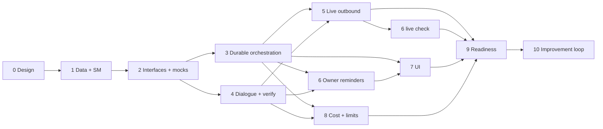

# Implementation plan

The per-phase checklist (objective, files, tests, acceptance, status) is in the
root **`status.md`**, which is canonical. This document explains the order,
dependencies, configuration and rollout that the checklist assumes.

## 1. Phase order and why it differs from the brief

| # | Phase | Brief's phase | Needs external accounts? |
| --- | --- | --- | --- |
| 0 | Research, audit, requirements, decisions | 0 | No |
| 1 | Domain model, migration, RLS, state machines | 1 | No |
| 2 | Provider interfaces, mocks, audio utils, `kriya-voice` skeleton | 2 | No |
| 3 | Durable call orchestration on mocks: tasks, confirm/cancel, claim loop, retries, idempotency, recovery, webhooks | 5 | No |
| 4 | Dialogue engine, STT/TTS/LLM integration, barge-in, outcome extraction, verification | 4 | Benchmark only (STT/TTS/OpenRouter keys; paid) |
| 5 | Controlled live outbound calls with Exotel, test numbers only | 3 | **Yes**: Exotel (X1–X11), counsel (Q1–Q2), deployed Supabase + Render |
| 6 | Owner reminders, spoken report, voice commands, number verification | 6 | Mocks first; live check needs Phase 5 |
| 7 | Mobile UI | 7 | No |
| 8 | Cost accounting, limits, monitoring, owner dashboard | 8 | Prices from vendors |
| 9 | Security testing, compliance review, recovery drills, production readiness | 9 | Counsel, external review |
| 10 | Continuous improvement loop (SELF_IMPROVEMENT.md, D-17) | — (added) | Counsel (Q11) for content use |

Before touching any existing file, read `CHANGE_IMPACT_AND_SAFETY.md`: it lists
the only allowed change per existing file, the protected files, and the stop
conditions.

Reasons (D-15): no new external side effect before its tests (durability
before live calls); the Exotel approvals take time and shouldn't block work that
doesn't need them; the dialogue engine can be built and measured against
mocks and recorded audio.



Phases 3 and 4 can run in parallel after Phase 2. Phase 7 can start once 3's
actions exist. Usage rows are written from Phases 3–4 onward (so no usage is
lost); Phase 8 adds pricing, charges, allowance and dashboards.

## 2. Configuration introduced

Secrets go in `SECRETS` (`lib/config.ts`) and `render.yaml` as `sync: false`.
Settings go in `SETTINGS` and are editable in `/owner/config`.

| Name | Kind | Service | Phase | Purpose |
| --- | --- | --- | --- | --- |
| `KRIYA_VOICE_ENABLED` | env | worker | 3 | Run the voice claim loop (mock or real) |
| `KRIYA_VOICE_LIVE` | env | worker | 5 | Allow the real provider (D-12) |
| `KRIYA_VOICE_URL` | env | worker, web | 2 | Public `wss://` base of `kriya-voice` |
| `KRIYA_PHONE_HASH_KEY` | secret | web, worker, voice | 1 | HMAC key for number hashes and codes |
| `EXOTEL_ACCOUNT_SID`, `EXOTEL_API_KEY`, `EXOTEL_API_TOKEN`, `EXOTEL_API_HOST`, `EXOTEL_CALLER_ID` | secret/env | worker, web | 5 | Provider API (host = `api.exotel.com` or `api.in.exotel.com` per account) |
| `KRIYA_VOICE_STREAM_SECRET` | secret | voice | 5 | Basic auth on the media WebSocket |
| `<VENDOR>_API_KEY` for chosen STT/TTS | secret | voice | 4 | Speech vendors |
| `voice.liveCalls` | setting | all | 5 | Platform switch (default off) |
| `voice.testNumbers` | setting | worker | 5 | Comma-separated E.164 allow-list until Phase 9 |
| `voice.telephony` | setting | worker | 5 | `exotel` / `mock` |
| `voice.stt`, `voice.tts`, `voice.ttsVoice` | setting | voice | 4 | Chosen by benchmark |
| `voice.model`, `voice.escalationModel` | setting | voice, web | 4 | OpenRouter ids (default: `routing.budget`) |
| `voice.maxConcurrentCalls` | setting | worker | 5 | Global cap (start 2) |
| `voice.dailySpendCapMicroInr` | setting | worker | 8 | Unset = no live calls |
| `voice.reportMaxSeconds`, `voice.reportWindowMinutes`, `voice.voicemailSilenceMs` | setting | worker, voice | 6 | VOICE_REMINDERS §9 |

## 3. New service on Render

```yaml title="render.yaml (Phase 2 addition, sketch)"
  - type: web
    name: kriya-voice
    runtime: node
    region: singapore
    buildCommand: npm ci
    startCommand: npm run voice
    healthCheckPath: /health
    envVars:
      - fromGroup: kriya-shared
      - key: DATABASE_URL
        sync: false
      - key: KRIYA_PHONE_HASH_KEY
        sync: false
      - key: KRIYA_VOICE_STREAM_SECRET
        sync: false
      - key: OPENROUTER_API_KEY
        sync: false
      - key: DB_POOL_MAX
        value: "4"
```

Deploying `kriya-voice` drops live calls on that instance unless drained;
Phase 2 implements drain on SIGTERM and Phase 9 rehearses it.

## 4. Branching, commits and approvals

- One branch per phase (`voice/phase-N-<slug>`) only when the owner authorizes
  commits; otherwise leave changes uncommitted and report them.
- Conventional Commits (`feat(voice): …`, `test(voice): …`).
- Never push to the `origin` remote (upstream project).
- Phase 5 (first live call) and every later live-call change require the owner's
  explicit go-ahead, recorded in `status.md` with date and the test numbers used.

## 5. Rollback

| Phase | Rollback |
| --- | --- |
| 1 | The migration only adds tables, functions and defaulted columns. Write `supabase/rollback/20261020000000_voice_core.down.sql` (the pattern of `20261016000000_kriya_core.down.sql`) and test down + up on PGlite like `tests/db/migrations.test.ts` does. Never edit an applied migration; fix forward with a new one |
| 2–4 | Code only; feature off unless `KRIYA_VOICE_ENABLED=1`. Remove the `kriya-voice` service from Render to stop it |
| 5 | `voice.liveCalls = off` (15 s cache) stops dials; unset `KRIYA_VOICE_LIVE` and redeploy the worker to be sure |
| 6 | Cancel pending `owner_report` calls with one SQL statement through the owner console action (to be added) |
| 7 | Hide `/calls` by removing the nav entry; routes remain protected |
| 8 | Charges are additive; revert `usageSummary` change if it misbehaves |
| 9 | — |
