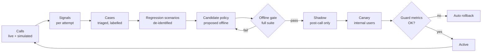

# Continuous improvement loop

Tavi gets better from its own failures through a **governed loop**: every
problem in a real or simulated call becomes data, then a regression test, then a
candidate fix, which ships only after it beats the current version on the full
evaluation and passes a staged rollout. Decision D-17.

## 1. What this is, and what it deliberately isn't

"Recursive self-improvement" in model research means a system that rewrites
its own weights or code without a person in between. For a product that phones
real people on someone's behalf, that's unsafe: an unreviewed change could
start agreeing to things, skip the AI disclosure or call twice, and no test
would have seen it first. So:

| Kriya's loop does | It never does |
| --- | --- |
| Turn every failure into a labelled case and a permanent regression scenario | Change production behaviour automatically |
| Let an offline agent (e.g. a Claude Code session) **propose** fixes: prompt wording, normaliser rules, thresholds, vendor/model choices, new scenarios | Let the live call model change its own prompt, tools or limits |
| Gate every change on the full evaluation, then shadow, then canary | Relax a safety guard to improve a metric |
| Version every behaviour bundle and record which version handled each call | Train on people's calls without a lawful basis and consent |
| Roll back automatically when guard metrics worsen | Retry or re-dial to "learn" |

Fine-tuning a model on Kriya data is out of scope until §8's conditions hold.

## 2. What can improve, and what is fixed

**Tunable** (lives in a versioned policy bundle):

- Prompt templates for each dialogue state and for outcome extraction
- Wording of Tavi's questions, read-backs and closings (not the disclosure)
- `en-IN` normaliser rules and the affirmative/negative lexicon
- Endpointing and barge-in thresholds, the silence timers
- STT keyword hints, TTS voice settings (speed, pauses)
- Model, STT and TTS vendor choices and fallbacks
- Retry gaps and report wording within the owner's settings

**Fixed** (code and SQL, changed only by a normal reviewed phase, never by the loop):

- The state machines and `voice_allowed_transitions`
- Authority checks (`note_agreement` guards, outcome verifier rules)
- The disclosure text (legal review), opt-out handling, suppression
- All limits, calling hours, budgets, D-12 switches
- Redaction, RLS, secrets handling
- The rule that the model never sets a status

## 3. The loop

### 3.1 Signals (automatic, no content)

Computed when an attempt is verified and stored in `attempt_metrics` (numbers
and codes only, so they can be kept longer than transcripts):

| Signal | Meaning |
| --- | --- |
| `verifier_status`, demotions (agreement → proposal) | Possible false agreement |
| `reasks`, `low_conf_entities` | STT or wording trouble |
| `bargeins`, `talk_over_ms` | Turn-taking trouble |
| `latency_p50_ms`, `latency_p95_ms`, `bargein_stop_p95_ms` | Speed |
| `invalid_tool_calls`, `escalated` | Model reliability |
| `end_reason`, `callee_hung_up_early` | Callee experience |
| `opt_out`, `wrong_person` | Targeting and courtesy |
| `cost_micro_inr` | Cost |
| `policy_version`, vendor/model versions | Attribution |

### 3.2 Explicit feedback

- **Owner, in the app:** on the outcome card, "Is this right?" → yes, or
  field-level corrections ("He agreed to 4, not 3:30"; "He didn't agree").
  Stored in `voice_feedback` with the field, the correction and the attempt.
- **Owner, by voice** on a report call: "That's wrong" → recorded as feedback
  with the turn reference; Tavi says the owner can correct it in the app.
- **Operator review:** the Kriya owner console shows counts and codes, never
  transcripts. Content-level review happens only on cases where the owner
  opted in (§6).

### 3.3 Cases and taxonomy

A weekly job groups signals and feedback into `voice_cases`, each with one
code from a fixed taxonomy:

`false_agreement` · `missed_proposal` · `wrong_time_parse` · `ambiguity_not_asked`
· `stt_entity_error` · `tts_mispronunciation` · `talked_over` · `slow_response`
· `invalid_tool_call` · `disclosure_issue` · `injection_attempt` ·
`sensitive_request` · `wrong_person_handling` · `report_not_delivered` ·
`provider_mismatch` · `cost_overrun` · `other`

`false_agreement`, `disclosure_issue` and any authority breach are **severity
1**: they page the owner, pause the policy version in canary, and block
promotion until fixed.

### 3.4 Every confirmed case becomes a regression scenario

The case is rewritten as a synthetic scenario in `tests/voice/scenarios/`
(EVALUATION_PLAN.md §1 format): names, numbers, places and anything
identifying are replaced; the conversation structure and the failing phrase
pattern are kept. The scenario gets the case id. **The evaluation set only
grows**, so a fixed problem can't come back unnoticed.

### 3.5 Candidate policies

A candidate is a new row in `voice_policy_versions` with a complete bundle (not
a diff applied at runtime), its parent version, the cases it targets, and who
proposed it. An offline agent may draft it, together with new scenarios, as a
normal code change for review. The live system only ever loads bundles marked
`shadow`, `canary` or `active`.

### 3.6 Gates

| Stage | What runs | Pass rule |
| --- | --- | --- |
| Offline | Full L-text suite (free, scripted + the real model in `voice:eval --text`); L-audio subset for STT/TTS/endpointing changes (paid, owner approves) | Zero-tolerance metrics (O2, S1, D1, S2) stay at zero; R1/R2 stay 100 %; the targeted metric improves, measured on ≥ 50 relevant runs; no other metric worse beyond its tolerance (O1 −1 pt, L1 p95 +150 ms, cost +10 %) |
| Shadow | For **post-call extraction and verification only**: the candidate re-extracts outcomes from stored turns of new opted-in calls; results are compared, never used | Agreement with the active version's accepted outcomes ≥ 98 %, or every disagreement reviewed and in the candidate's favour |
| Canary | Live dialogue changes can't be shadowed safely, so they go to the owner's internal allow-list first, then a hashed % of voice users (5 % → 25 % → 100 %), ≥ 7 days or ≥ 100 calls per step | Guard metrics within thresholds; no severity-1 case |
| Rollback | Automatic: any severity-1 case, `needs_review` rate +50 % over active, opt-out rate doubled, D1/S1 event → the setting `voice.policyVersion` reverts to the previous active | Logged in `voice_transitions`-style audit and `kriya.audit_events` |

### 3.7 Drift

Vendors change models without notice. A weekly scheduled run of a fixed
30-scenario L-audio set (small, paid, owner-approved budget) compares results
with the last run and opens a `provider_drift` case if any metric moves past
its tolerance.

## 4. Data model additions (Phase 10 migration, except the stamp)

| Table / column | Purpose |
| --- | --- |
| `call_attempts.policy_version text not null` | **Added in Phase 1** so every call ever made is attributable |
| `voice_policy_versions` | `id`, `parent_id`, `bundle jsonb`, `bundle_hash`, `status` (`draft`, `shadow`, `canary`, `active`, `retired`, `rolled_back`), `targets text[]` (case ids), `eval_report jsonb`, `proposed_by`, `approved_by`, timestamps. No user grants |
| `attempt_metrics` | One row per attempt, numbers and codes from §3.1; `user_id on delete set null`; select-own grant |
| `voice_feedback` | `id`, `user_id`, `call_attempt_id`, `field`, `was`, `should_be`, `source` (`app`, `voice`), `created_at`; select-own, insert through an action |
| `voice_cases` | `id`, `code`, `severity`, `status` (`open`, `fixed`, `wontfix`), `attempt_ids uuid[]`, `scenario_ids text[]`, `fixed_in_version`; no user grants |
| `voice_profiles.improvement_opt_in boolean default false` | Owner consent to let Kriya review their call content for improvement (§6) |

## 5. Who does what

| Role | Responsibility |
| --- | --- |
| Worker janitor (automatic) | Computes `attempt_metrics`; weekly case grouping; drift run when approved |
| Offline improver (a coding agent, on request) | Reads open cases, writes de-identified scenarios, proposes a bundle, runs the free offline gate, writes the eval report |
| Kriya owner | Approves paid evals, approves promotion from draft → shadow → canary → active |
| Product code | Loads the bundle named by `voice.policyVersion`; stamps it on every attempt; enforces the fixed guards regardless of bundle |

## 6. Privacy and consent

- Signals in `attempt_metrics` carry no content and are allowed under the same
  basis as the service itself (confirm with counsel, Q11 below).
- **Content** (transcript text) is used for improvement only when the owner
  opted in, only within the transcript retention window, and only to write a
  de-identified scenario. The recipient's words are personal data of someone
  who never signed up; whether even de-identified use is permitted is a question
  for counsel (Q11). Until answered, scenarios come only from simulated calls,
  internal test calls and owner-written descriptions of what went wrong.
- Nothing from a call is sent to a third party for training. Vendor settings
  that allow data use for vendor model training are switched off where offered
  (check each vendor in Phase 4 and record it).
- Q11 (added to SECURITY_AND_COMPLIANCE §8): may Kriya use de-identified call
  transcripts, with the owner's consent, to build test scenarios; does the
  recipient's data need its own basis?

## 7. Metrics that show the loop works

Tracked per policy version in `/owner/operations`:

- O1, O2, S1, D1, R1, L1, L2, C1 from EVALUATION_PLAN.md §4, on live calls
- `needs_review` rate; owner correction rate per 100 outcomes
- Time from case opened to fixed; share of cases with a regression scenario
  (target 100 %)
- Scenario count over time (should only rise)

## 8. Conditions before any fine-tuning

All must hold, then a separate decision (D-xx) is written:

1. Counsel confirms a lawful basis for using the data (Q11).
2. ≥ 1,000 consented, de-identified, human-checked examples for the target
   behaviour.
3. Prompt, rule and vendor changes have plateaued on that behaviour (measured).
4. The fine-tuned model passes the same gates as any policy version, plus a
   memorisation check (no training names or numbers reproduced).

## 9. Phases

- **Phase 1:** `call_attempts.policy_version` column; the current bundle is
  `v1` and lives in `lib/voice/policy/v1.ts` (code, reviewed).
- **Phase 4:** the dialogue engine loads prompts and thresholds from the bundle,
  not from scattered constants; the evaluation runner reports per version.
- **Phase 7:** "Is this right?" on outcomes.
- **Phase 10 (after Phase 9):** tables in §4, metrics job, case grouping,
  shadow and canary machinery, rollback trigger, owner console views.
