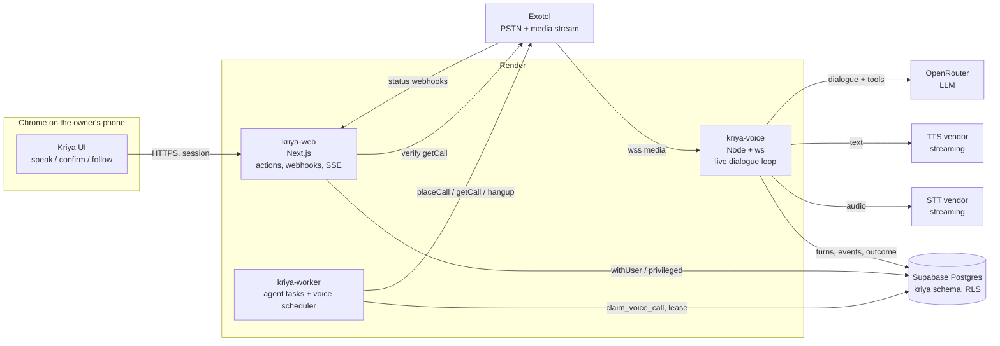

# Voice architecture

How a Kriya Tavi call works end to end, the components, and how each one is
chosen. Decisions referenced: D-01 to D-04, D-11, D-14 (DECISIONS.md).

OpenRouter is only the LLM gateway. Telephony, speech recognition and speech
synthesis are separate providers with separate keys, bills and failure modes.

## 1. System view



| Service | Owns | Never does |
| --- | --- | --- |
| `kriya-web` | Task creation, confirmation, cancel, history, status webhooks, verification, live status for the UI | Place calls; hold call audio |
| `kriya-worker` | Scheduling, claiming, placing and retrying calls, recovery, janitor, charges | Hold audio; talk to the callee |
| `kriya-voice` | The media WebSocket of a connected call; STT/LLM/TTS loop; in-call tools; turn and outcome writes | Place new calls; read anything but the current attempt's task spec |

`kriya-voice` gets the task spec by attempt id after validating the stream
token, through `privileged` scoped by `user_id` (bookkeeping with its own
authorization check, per AGENTS.md invariant 1). It never reads threads,
memories or connected accounts: the callee's words can't reach the owner's
other data.

## 2. A call, step by step

```mermaid
sequenceDiagram
  participant O as Owner (browser)
  participant W as kriya-web
  participant DB as Postgres
  participant K as kriya-worker
  participant X as Exotel
  participant V as kriya-voice
  participant C as Callee
  O->>W: "Call my CA…" (text or dictation)
  W->>W: extract spec (LLM, structured) → draft
  W-->>O: confirmation card (number, purpose, authority, report time)
  O->>W: confirm(approvalId, payloadHash)
  W->>DB: approval approved; task authorized; voice_call outreach scheduled
  K->>DB: claim_voice_call → dialing; attempt requested (commit)
  K->>X: placeCall
  X->>C: ring
  C-->>X: answer
  X->>V: wss start (token, call_sid)
  V->>DB: attempt connected
  V->>C: "Hello, this is Kriya Tavi, an AI assistant calling for <owner>…"
  loop turns
    C->>V: speech → STT
    V->>V: dialogue engine (LLM + call tools)
    V->>C: TTS
  end
  V->>X: end_call (or callee hangs up)
  X->>W: status completed
  W->>X: getCall (verify)
  W->>DB: attempt ended+verified; outcome extracted+verified; task awaiting_report
  Note over K: at report_at (6 PM, owner's timezone)
  K->>X: placeCall to owner's verified number
  X->>V: wss start
  V->>O: spoken report; marks confirm playback; owner commands
  V->>DB: delivered_at; task completed
```

## 3. Telephony

Primary Exotel, secondary Plivo, Twilio excluded for India (D-02). Protocol,
events, codec, chunking, callbacks, limits and account checks:
`TELEPHONY_PROVIDER_ASSESSMENT.md`. Points that shape the design:

- **Audio format:** 16-bit PCM mono, 8 kHz default, 16 kHz available. Kriya
  requests 16 kHz if the account supports it (X9) and resamples for vendors.
- **Chunking:** outgoing audio in 100 ms chunks (3,200 bytes at 16 kHz is
  1,600 samples = 100 ms; at 8 kHz, 1,600 bytes is below Exotel's 3.2 KB minimum,
  so use 200 ms = 3,200 bytes). `lib/voice/audio.ts` enforces multiples of 320
  bytes. Exotel's docs equate 3.2 KB with 100 ms, which holds only at 16 kHz;
  confirm on the account (X9).
- **Barge-in:** Exotel's `clear` drops only audio that hasn't started playing,
  so at most one chunk (100–200 ms) keeps playing after the callee starts
  talking. Kriya keeps ≤ 2 chunks queued ahead at any time.
- **Played vs sent:** a `mark` after each sentence tells Kriya what was
  actually heard (needed for D-08 and for `conversation_turns.played_ms`).
- **Lifecycle events:** status webhooks to `kriya-web`; stream `start`/`stop`
  to `kriya-voice`. Both write `call_events`; the transition function
  reconciles them (DATA_MODEL §3.3).
- **Timeouts:** ring timeout 30 s (`TimeOut`); max call 5 min for outreach,
  3 min for owner reports (`TimeLimit`, also enforced by `kriya-voice`).
- **Rate limits:** Exotel 20 calls/min per account; Kriya's own limits are far
  lower per user (SECURITY_AND_COMPLIANCE.md §5).

## 4. Speech recognition

Requirements: streaming partials; end-of-utterance detection; confidence if
available; telephone audio (8/16 kHz); Indian English accents; numbers, names,
dates and times; robust to noise and cross-talk; vocabulary hints (the owner's
name, the recipient label, the proposed times).

| Candidate | Why it's on the list | To verify |
| --- | --- | --- |
| Deepgram Nova-3 (streaming) | Mature streaming API, endpointing and `speech_started` events, keyterm prompting; `en-IN` availability to confirm | Price (sources conflict: $0.0048 vs $0.0077/min), `en-IN` support, region latency from Singapore |
| Sarvam Saaras (streaming) | Indian company and data residency, built for Indian speech, ₹30/hour published, path to Hindi/Telugu later | English telephone accuracy, streaming endpoint behaviour, partials |
| Google Cloud Speech (Chirp, `en-IN`) | Strong `en-IN` support, Mumbai region | Price, streaming partial latency |

Endpointing is two-layer: the vendor's endpoint event plus Kriya's own rule
(silence ≥ 700 ms after a final, or a final ending in a question mark, tuned on
recordings). Barge-in uses the vendor's speech-start event, gated by ≥ 250 ms of
speech energy so a cough doesn't cut Tavi off.

Numbers and times: STT text is normalized by `lib/voice/languages.ts`
(`en-IN`): "three thirty", "half past three", "15:30", "saade teen" (later) →
`15:30` in the owner's timezone with the date resolved against the task's
reference date ("tomorrow" = task creation date + 1 in the owner's timezone).
Unresolvable → asked back (CONVERSATION_AND_VERIFICATION.md §4).

## 5. Dialogue and reasoning

- **Gateway:** OpenRouter through the existing `createGatewayModel` and
  `modelForTier` (`lib/models.ts`). No new gateway code.
- **Default model candidate:** `deepseek/deepseek-v4-flash` (live catalogue
  2026-10-16: $0.091 / $0.182 per 1M tokens, tools + structured output
  declared). Declared support isn't proof (docs/kriya/status.md): it must pass
  `npm run models:eval` and the voice benchmark (EVALUATION_PLAN.md §3) on
  tool-call validity and **time to first token**, which dominates voice latency.
- **Fallback:** `routing.fallback` (owner-set). Used on provider failure for
  the next turn, not a retry of the whole call.
- **Escalation:** a separate setting `voice.escalationModel`, used after two
  consecutive invalid tool calls or schema failures in one call, or for the
  post-call outcome extraction if the default fails validation. Bounded: one
  switch per call.
- **Shape of a turn:** the model gets a small system prompt built from the
  structured spec (not free text), the conversation so far, and the call tools
  (D-14). It must answer with either a short utterance, a tool call, or both.
  Output tokens capped (~120) per turn; at most 2 tool calls per turn; per-call
  step and cost budgets.
- **State is in code, not the prompt:** the dialogue engine tracks the
  conversation state (CONVERSATION_AND_VERIFICATION.md §3) and passes the
  allowed next moves in the prompt; tools outside the current state's set are
  rejected by code.

## 6. Speech synthesis

Requirements: natural Indian-English voice, streaming first audio < 300 ms,
cancel on barge-in (abort the request and stop sending chunks), one consistent
voice identified as "Kriya Tavi", output at 8/16 kHz PCM or convertible.

| Candidate | Published price (secondary) | Notes |
| --- | --- | --- |
| Sarvam Bulbul v2 | ₹15 / 10K chars | Indian voices; streaming support to verify |
| ElevenLabs Flash v2.5 | ~$50 / 1M chars | ~75 ms first audio claimed |
| Cartesia Sonic | ~$49 / 1M chars | 90 ms claimed, 166–190 ms measured by a third party |
| Deepgram Aura-2 | $0.030 / 1K chars | Same vendor as STT option |

**No voice cloning.** Tavi uses a stock voice from the vendor's library,
never a clone of the owner or anyone else (SECURITY_AND_COMPLIANCE.md §6).
TTS failure mid-call: retry the sentence once; if TTS is down, say nothing more
and end the call politely only if a fallback TTS is configured; otherwise end
the call and record `end_reason = 'tts_failed'` (the outcome then says so).

## 7. Chained vs speech-to-speech

| Criterion | Chained STT → LLM → TTS | Speech-to-speech (e.g. OpenAI gpt-realtime) |
| --- | --- | --- |
| Controllability | Every turn is text; tools validated by code before anything is said | Model speaks directly; harder to hold to a tool schema mid-utterance |
| Latency | Sum of parts: target p50 ≤ 1.5 s, p95 ≤ 2.5 s (to measure) | Lower, typically |
| Cost | STT ~$0.005/min + TTS ~$0.01–0.03/min (at ~150 words/min) + small LLM (secondary prices) | Analyst estimate $0.06–0.11/min flagship, $0.02–0.05 mini |
| Reliability | Each vendor can be swapped or fall back alone | Single vendor |
| Auditability | Full text transcript by construction | Needs a separate transcription |
| Telephone audio | STT vendors tune for 8 kHz | Varies |
| Fit with Kriya | OpenRouter + existing metering | Not on OpenRouter; separate key and metering |

**Initial architecture: chained (D-04).** Revisit speech-to-speech only if the
chained loop misses the latency target after tuning, and only with the same
tool-validation and transcript guarantees.

## 8. Latency budget (targets, to be measured)

| Step | Target |
| --- | --- |
| End-of-utterance detection after callee stops | ≤ 700 ms |
| LLM time to first token (short prompt, ~1.5K tokens) | ≤ 500 ms |
| TTS time to first audio | ≤ 300 ms |
| Network (Exotel ↔ Singapore ↔ vendors) | ≤ 150 ms |
| **Callee stops → Tavi starts speaking** | **p50 ≤ 1.5 s, p95 ≤ 2.5 s** |
| Barge-in: callee starts → Tavi audio stops | ≤ 400 ms |

Streaming overlap: start TTS on the first complete sentence of the LLM output;
send a short filler ("Sure.") only if the policy allows it, never a filler that
implies agreement.

## 9. Orchestration summary

| Need | Mechanism |
| --- | --- |
| Durable task execution | `voice_tasks` + `voice_calls` in Postgres; worker claim loop (D-05) |
| Streaming conversation control | `kriya-voice` per-call loop; in-memory state is a cache of `conversation_turns` |
| Call/task state sync | Only `kriya.voice_transition()`; webhooks, stream events and verifier all feed it |
| Scheduled reminders | `voice_calls(kind='owner_report', not_before=report_at)` |
| Tool authorization | Call tools allowed per dialogue state; no side-effect tools in calls (D-14) |
| Verified results | `lib/voice/verify.ts` + provider `getCall()`; task terminal edges need evidence |

## 10. Languages later

`lib/voice/languages.ts` holds, per language: STT provider + model, TTS voice,
prompt templates, number/time normalizer, the disclosure sentence, and the
evaluation dataset path. Hindi or Telugu is added by a registry entry plus a
benchmark run that passes the same thresholds; no change to the engine. Code
switching (Hinglish) is a separate entry, evaluated on its own data.
