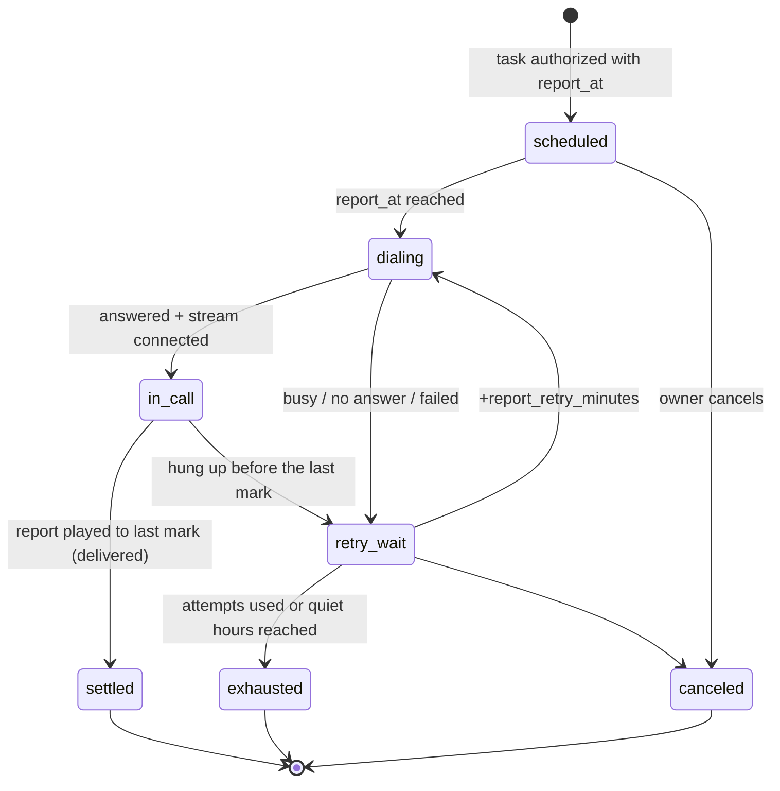

# Owner voice-only reminders

Reminders and outcome reports reach the owner **only by a telephone call** to
their verified number (D-07). This document defines how those calls are
scheduled, retried, proven delivered and controlled by voice.

## 1. Default policy

| Rule | Default |
| --- | --- |
| Channel | Phone call to the verified owner number |
| Push notifications, SMS, WhatsApp, email | **Off. Never used as a fallback** |
| Missed reminder | Retried by phone within the owner's policy; then marked undelivered |
| Web app | Shows history, upcoming report calls and failures when the owner opens it; it doesn't notify |
| Other channels | Only a future, explicit per-owner opt-in (not in MVP) |

Code consequence: no voice code path may call `Notification`, the existing
`notifier.tsx`, `/api/events`, an SMS or email API. A test asserts that a
missed report produces no row or event outside the voice tables
(TEST_STRATEGY.md, T-REM-07).

## 2. Prerequisites for any owner call

1. **Verified owner number** (`voice_profiles.owner_phone_verified_at` set) by
   the verification call (D-13): Kriya calls the number, the owner keys in the
   6-digit code shown on screen. Changing the number clears verification and
   cancels scheduled owner calls until the new number is verified.
2. **Timezone** (`voice_profiles.timezone`, default `Asia/Kolkata`). All report
   times are stored as `timestamptz` computed from the owner's local time at
   creation; the local time and timezone are kept in the task spec for display.
3. **Quiet hours** (default 21:30–08:00 local). A report time inside quiet hours
   is refused at confirmation with a suggested time, never silently moved.
4. **Retry policy**: `report_max_attempts` (default 3, max 5) and
   `report_retry_minutes` (default 10). Retries never enter quiet hours.

## 3. Lifecycle of a report call

The window for a report is `[report_at, min(report_at + 2 h, next quiet-hours
start))`; after it, the call is `exhausted` and the task becomes `unreported`.
The outcome stays visible in the app.

## 4. What each stage means

| Stage | Evidence | Counts as delivered? |
| --- | --- | --- |
| Call initiated | Provider returned a call id (`call_attempts.initiated_at`) | No |
| Phone rang | Ringing callback, if the provider sends it | No |
| Call answered | Provider status `in-progress`/answered, `answered_at` | No (could be voicemail or someone else) |
| Stream connected | Validated `start` on `kriya-voice`, `connected_at` | No |
| Report played | `mark` for the last chunk of the report received while connected (`last_report_mark_at`) | **Yes: `delivered_at`** (D-08) |
| Acknowledged | Owner said/keyed a recognised confirmation after the report | Yes, and `acknowledged_at` |

The report starts with a short identity check that costs one turn: "Hi, this is
Kriya Tavi with your update about the call to your CA. Is this <owner first
name>?" If the answer is a clear no, Tavi says "Sorry, wrong person", ends the
call without any task details, and the attempt counts as failed
(`end_reason = 'not_owner'`). A yes, or any reply that isn't a no, continues to
the report. Silence gets the question once more; silence again (8 s in total
since the greeting) is treated as voicemail. This protects against a reassigned
number or a family member answering.

Voicemail: if the provider's `AnsweredBy` reports a machine (X10, unverified)
or the silence rule above triggers, Tavi hangs up without giving details —
**it never leaves the outcome on voicemail** — and the attempt counts as
failed.

## 5. Report in the same call or a separate one

Options considered:

| Option | Pros | Cons |
| --- | --- | --- |
| A. Owner-chosen time (e.g. 6 PM) report with whatever the outcome is by then | Matches the scenario; one call; predictable | If the outreach call hasn't happened yet, the report says so |
| B. Report as soon as the outreach call settles | Fastest news | Can interrupt the owner; extra call if they also asked for a 6 PM call |
| C. Both | Complete | Twice the calls and cost |

**Recommendation: A by default** (`report_mode = 'scheduled'`), B available as
`on_completion` (report within 2 minutes after the outreach call settles, inside
the owner's calling hours). The report content is generated from the
**verified** outcome at dial time, so a 6 PM call always tells the truth as of
6 PM: "I haven't been able to reach him yet. I tried twice, at 4:10 and 4:20; the
line was busy."

If the owner asked for no report, `report_requested = false` and the task
completes when the outreach call settles.

## 6. Durability and no duplicate calls

- The report call is a `voice_calls` row created at authorization time
  (`kind = 'owner_report'`, `seq = 1`), so it survives restarts by construction.
  The unique key `(voice_task_id, kind, seq)` makes creating it idempotent.
- Claimed with a lease like every voice call (DATA_MODEL §4). An attempt is
  committed as `requested` before the provider API is called.
- Worker crash after `requested`: the next worker reconciles with the provider.
  For owner calls (unlike third parties) an unprovable attempt may be retried,
  because the owner opted into these calls; it still counts against
  `report_max_attempts`, which bounds the worst case.
- Provider outage: `placeCall` failing with a 5xx or network error counts as an
  attempt with `failed`, retried by the normal schedule; never in a tight loop.
- Clock: `not_before` and `available_at` are compared with database `now()`, not
  the worker's clock.
- Daylight saving doesn't apply to `Asia/Kolkata`, but timezone math uses IANA
  names so other zones work (`Intl` / `date-fns`, already a dependency).

## 7. Cancelling, postponing, asking — by voice

On any owner call (report or a call the owner places to Tavi later, not in
MVP), after the report Tavi offers: "You can ask me something, or say 'that's
all'." Recognised intents, all bounded to the owner's own data:

| Owner says | Effect | Confirmation |
| --- | --- | --- |
| "What time did he suggest?" | Reads `proposed_times` from the verified outcome | None (read only) |
| "Repeat that" | Replays the report | None |
| "Cancel that reminder" / "cancel the other reminders" | Cancels pending owner calls for this task | Tavi repeats back what will be cancelled; owner says yes |
| "Remind me again at 8" | Creates the next `owner_report` call (`seq + 1`) at 20:00 local, if outside quiet hours and within limits | Repeat back; yes |
| "Call him again tomorrow" | Creates a **draft** follow-up task; nobody is called until the owner confirms it in the app (D-09) | Tavi says so explicitly |
| Anything else | "I can't do that on this call; you can do it in the Kriya app." | — |

Voice commands map to the same server functions the app uses
(`lib/voice/tasks.ts`), with `actor = 'owner'` and evidence
`{ attemptId, turnSeq }` in `voice_transitions`. They're only accepted on an
attempt whose `to_phone_e164` equals the verified owner number and which passed
the identity check.

## 8. Bounded retries — worked example

Report at 18:00 IST, 3 attempts, 10-minute gap, quiet hours from 21:30:

| Attempt | Time | Result |
| --- | --- | --- |
| 1 | 18:00 | No answer → retry_wait |
| 2 | 18:10 | Busy → retry_wait |
| 3 | 18:20 | Answered, owner hangs up mid-report → no attempts left → `exhausted` |

Task → `unreported`. The app's task page shows "We couldn't finish telling you
the result: tried 18:00, 18:10, 18:20." No other channel is used.

## 9. Configuration

| Setting | Where | Default |
| --- | --- | --- |
| Owner timezone, quiet hours, attempts, retry gap, report mode | `voice_profiles` (owner edits in the app) | §1–2 |
| Max report call duration | `voice.reportMaxSeconds` in `SETTINGS` | 180 |
| Report window length | `voice.reportWindowMinutes` | 120 |
| Voicemail silence threshold | `voice.voicemailSilenceMs` | 8000 |
