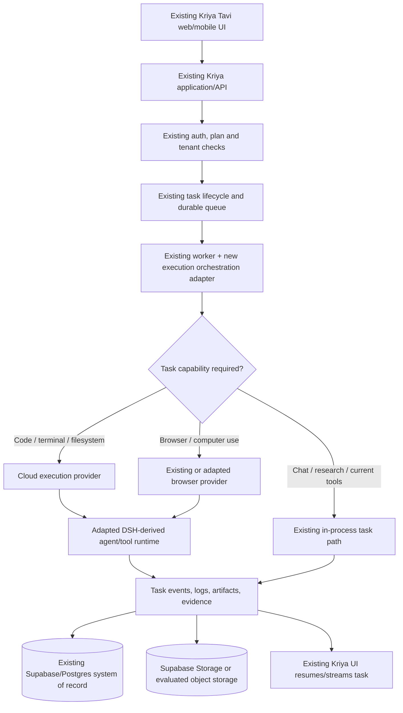

# Kriya Tavi — Cloud Execution Environment & Harness Integration

**Architecture discovery brief, product intent, research notes, constraints, and Claude Code operating mandate**  
**Prepared:** 31 October 2026  
**Primary implementation owner:** Claude Code (acting as principal architect and engineering lead)  
**Product:** Existing Kriya Tavi platform by Kriya AI  
**Existing repository reviewed:** <https://github.com/zuko14/Kriya-Tavi>  
**Open-source architecture to evaluate:** <https://github.com/deepseek-ai/deepseek-harness>

---

## 0. The most important instruction

**Extend the Kriya Tavi that already exists. Do not build a second, separate harness product, a parallel agent platform, or a replacement application.**

Kriya Tavi is already developed to a meaningful extent. It has an existing UI, user and agent concepts, a task lifecycle, background execution, model routing, memory, squads/delegation concepts, metering, billing, administration, Supabase data model, and Render deployment configuration.

The objective is to add a powerful cloud execution environment to the existing Kriya Tavi experience so agents can use cloud-hosted tools and workspaces to complete real tasks without relying on a user's laptop. DeepSeek Harness is a major open-source source-code and architecture candidate for accelerating this work. Its architecture and useful components should be deeply studied and reused/adapted wherever technically appropriate and legally permitted.

The outcome must feel like a natural extension of the existing Kriya Tavi product. Existing users should not feel that they have been redirected into a different application or a disconnected second agent system.

**Claude Code is responsible for the final engineering and architectural decisions.** It must inspect the actual working repository, existing implementation, tests, deployment configuration, and current provider capabilities before deciding what to reuse, adapt, replace, defer, or reject. This document expresses the product intent and decision criteria; it is not permission to blindly impose a predetermined architecture.

---

## 1. Founder intent and desired outcome

### 1.1 Product vision

Kriya Tavi should let a user create or select an agent, assign a meaningful task, leave the application or close their laptop, and later return from a phone or browser to see the work continuing or completed.

The agent should be able to obtain the appropriate cloud capabilities for the task, such as:

- A terminal and controlled shell execution.
- A temporary or resumable code workspace.
- Repository access through GitHub.
- File read/write and artifact generation.
- Browser automation and, where justified, computer-use capabilities.
- Curated skills and reusable procedures.
- Agent memory and project context.
- Subagent delegation and team coordination.
- Long-running workflows, schedules, retries, and recovery.
- Progress events, logs, evidence, approvals, and transparent cost reporting.

The user should not have to keep a laptop awake, run a local agent process, install a desktop runtime, or manually maintain a development environment for normal cloud tasks.

### 1.2 Experience target

The desired experience should be competitive with the best parts of current agent products, including the user's references to Claude/Cowork-style cloud work, ChatGPT Work and dots, Grok-style bots, and similar autonomous assistants.

The target experience is capability-based, not a request to copy another company's product or UI:

1. Start a task from mobile or web.
2. Let the agent plan and execute multi-step work in the cloud.
3. Close the tab or device without stopping the task.
4. Return to the same task and inspect progress.
5. See what tools/actions were used and what changed.
6. Review deliverables such as code changes, files, reports, or pull requests.
7. Approve consequential actions when needed.
8. See the actual cost in INR and understand which model, tool, and compute usage contributed to it.
9. Reuse the agent, skills, memory, and project context later.

Kriya Tavi should aim to deliver a strong experience at a substantially lower and more transparent operating cost. It must not attempt to undercut competitors by removing necessary security, verification, or reliability controls.

### 1.3 Primary use case for the first proof of concept

The most useful first demonstration is a cloud-based software development task:

- User connects a permitted GitHub repository.
- User assigns an engineering task from Kriya Tavi.
- Kriya creates or resumes a controlled cloud workspace.
- Agent inspects the repository, plans the work, edits code, runs tests, and records its activity.
- Agent returns a summary and evidence, and optionally opens a pull request.
- The laptop may be closed throughout the process.
- Production deployment remains gated by explicit approval and configured policy.

This proof of concept should use the existing Kriya Tavi task and billing flows wherever practical. It should not require building a separate product shell.

---

## 2. Existing Kriya Tavi: baseline that must be preserved

The public repository `zuko14/Kriya-Tavi` was inspected on 31 October 2026. The local working checkout may be newer or different, so Claude Code must verify every item below against the actual checkout before implementation.

### 2.1 Existing stack and deployment shape

The repository documentation describes:

- Next.js 16 / React web application.
- TypeScript and Node.js services.
- Render deployment, including the web application and background worker.
- Supabase Auth and PostgreSQL as the primary identity and application data platform.
- A private `kriya` PostgreSQL schema with tenant-aware RLS policies.
- OpenRouter as the model gateway, with configurable model tiers and fallbacks.
- Firecrawl for web research/search/fetch capabilities.
- Razorpay subscription/billing integration.
- INR-aware plans, usage allowances, model/tool metering, and an owner operations console.
- Existing task events and a browser-based interface for following work.

Repository entry points and documents to inspect first:

- `README.md`
- `AGENTS.md`
- `docs/kriya/architecture.md`
- `docs/kriya/deployment.md`
- `docs/kriya/security.md`
- `docs/kriya/status.md`
- `render.yaml`
- `worker/index.ts`
- `browser/`
- `lib/agent/`
- `lib/models.ts`
- `lib/entitlements.ts`
- `lib/memory/`
- `supabase/migrations/`
- `tests/`

### 2.2 Existing task lifecycle

The architecture documentation describes an existing durable task flow:

1. The web application authenticates the user and validates a task request.
2. It checks entitlement, plan limits, model tier, and concurrency.
3. It writes the user message and queued task transactionally.
4. A background worker claims tasks from Postgres using a database claim function and row locking (`FOR UPDATE SKIP LOCKED`).
5. The worker maintains a lease/heartbeat, executes the task, and records task events.
6. Model usage, tool execution, cost, and final task outcome are written to the database.
7. A closed browser tab stops viewing the task, not the task itself.
8. Recovery logic handles worker crashes and retries under bounded rules.

This is valuable existing infrastructure. **Do not replace the current queue/orchestration design just because an open-source harness also has sessions, jobs, workflows, or an agent loop.** First establish exactly what each system currently owns and whether a new component solves a measured gap.

### 2.3 Existing product capabilities already described in the repo

The repository documentation and code structure indicate existing work around:

- User accounts, authentication, tenant isolation, and an owner console.
- Agents with roles and memory.
- Background tasks, task event streaming/replay, cancellation and recovery.
- Squads / agent delegation concepts.
- Model tiers, fallbacks, cost/usage recording, and plan enforcement.
- Memory inspection and management.
- Scheduled work and recurring task foundations.
- Skills-related data/actions/feature flags in parts of the codebase; the status/roadmap documents may not consistently describe their current implementation state.
- A separate browser service and browser-related code.
- Voice-related service code.

Claude Code must distinguish between **implemented**, **feature-flagged**, **partially implemented**, **tested locally**, **verified against real external services**, and **deployed/working in production**. Do not infer capability completion from a migration, folder, or UI element alone.

### 2.4 Known documentation inconsistencies to reconcile

The public repository snapshot contains possible status mismatches. For example, the README and architecture/status documents describe browser/computer execution as not fully available or not started, while the repository also contains browser service code and a Render Blueprint entry for a private browser service. Skills are also described differently across feature flags, code paths, and roadmap/status documents. The status document refers to a branch name that may not match the repository's current default branch.

These may simply be stale documents or partially completed features. Claude Code must inspect code, migrations, tests, Render configuration, and deployed status where access is available; then update the project status accurately. Never treat this brief or an old status page as more authoritative than the actual code.

### 2.5 Existing architecture principles to retain

Unless repository evidence shows otherwise, preserve these useful principles:

- Supabase/Postgres is the authoritative store for durable application state.
- Tenant data is accessed through the established RLS-aware access paths.
- Privileged database access remains server-only and tightly scoped.
- User/browser clients must not gain direct access to private tenant schema tables.
- Tasks have idempotency, explicit status transitions, leases/heartbeats, deadlines, bounded retries, and cancellation semantics.
- Side-effecting actions must not be blindly retried.
- Usage and customer billing are recorded and reconciled.
- Secrets remain server-side.
- Development, staging, and production environments remain isolated.
- Existing UI, onboarding, agent identities, threads, plans, and billing should remain compatible.

---

## 3. DeepSeek Harness research and intended use

### 3.1 Source project

- Repository: <https://github.com/deepseek-ai/deepseek-harness>
- Architecture documentation: <https://github.com/deepseek-ai/deepseek-harness/blob/master/docs/architecture.md>
- Agent/developer instructions: <https://github.com/deepseek-ai/deepseek-harness/blob/master/AGENTS.md>
- License: <https://github.com/deepseek-ai/deepseek-harness/blob/master/LICENSE>
- Official product overview: <https://www.deepseek.com/en/harness/>

The repository is a modular agent harness built around Cordis and a composable plugin tree. Its central design idea is that capabilities are mounted as plugins/services, with typed events and replaceable providers. The architecture documentation describes profiles/bundles and extension seams for model adapters, tools, shells, terminals, filesystems, sandboxing, persistence, UI and agent behavior.

The repository includes package families covering areas such as:

- Core agent interfaces and agent loop.
- Sessions, durable session events and persistence.
- Model/LLM adapters and streaming vocabulary.
- Tool registry and guarded tool execution.
- Shell, subprocess and SSH providers.
- Terminal / PTY management.
- Sandbox and process confinement.
- Filesystem and workspace access.
- Skills and context assembly/compaction.
- Subagents and experimental agent teams.
- Workflow, jobs, schedules and goals.
- Browser use and computer use.
- MCP and language-server integrations.
- Credentials, settings, interaction/approval, storage and telemetry.
- SDK/API and Web client/host applications.

The actual list and maturity of packages must be obtained from the pinned source revision, not from this summary.

### 3.2 What we want from this source

Use DeepSeek Harness as a substantial source-code and architecture donor. Claude Code should review its packages and source implementation in depth and map each relevant subsystem against Kriya's existing implementation.

The goal is to reuse as much proven engineering as is useful, avoid reinventing mature capabilities, and adapt them to Kriya's existing product architecture.

This does **not** mean blindly copying every package, replacing working Kriya systems, or importing the entire standalone DeepSeek application as another application inside Kriya.

### 3.3 Required package-by-package evaluation

Create a component mapping table with at least these decisions:

- **Reuse:** component is suitable with minimal adaptation.
- **Adapt:** component is useful but must be changed to fit Kriya tenancy, persistence, APIs, security or deployment.
- **Extend:** existing Kriya implementation is retained and gains a capability or provider from DSH.
- **Keep existing:** Kriya already has a suitable implementation; avoid duplicate systems.
- **Defer:** valuable but not necessary for the initial cloud-execution release.
- **Reject:** incompatible, unsafe, too costly, immature, redundant, or not justified.

The mapping must cover, where present in the pinned upstream version:

1. Cordis/plugin runtime and service model.
2. Agent interface and agent loop.
3. Session/event model and persistence adapters.
4. Model adapters and streaming.
5. Tool registry, lifecycle and pre/post-execution guards.
6. Shell, process execution and subprocess control.
7. Filesystem and workspace interfaces.
8. Terminal / PTY.
9. Sandbox/process confinement.
10. Browser and computer-use components.
11. Skills loading and selection.
12. Subagents and agent-team coordination.
13. Workflow, job, scheduler and goal abstractions.
14. Context assembly, compaction and attachment handling.
15. MCP, LSP, external integrations and API/SDK.
16. Credentials, approvals, interaction and telemetry.
17. Web/desktop user interface and application boot profiles.

For every component, document:

- What it does in upstream.
- Its actual public/internal API and lifecycle.
- Existing Kriya equivalent, if any.
- Whether its assumptions fit the current Kriya task and tenant model.
- Reuse/adapt/extend/keep/defer/reject decision.
- Dependencies and license considerations.
- Runtime and compute cost implications.
- Test coverage and known limitations.
- Migration and rollback implications.

### 3.4 Do not confuse the harness with the model

DeepSeek Harness is an agent execution/harness project, not a requirement to use DeepSeek models. Preserve Kriya's provider-independent model gateway and OpenRouter routing unless the audit proves a change is beneficial.

Kriya must remain able to use multiple model providers, compare models, select tiers, record actual provider usage, fall back safely, and change models without redesigning the product runtime.

### 3.5 License and upstream governance

The DeepSeek Harness repository currently declares an MIT license. MIT generally permits commercial use, modification, redistribution and sublicensing, subject to retaining required copyright and permission notices in copies or substantial portions.

Before copying or redistributing code:

- Pin an exact upstream commit SHA/tag.
- Preserve the upstream MIT copyright and permission notice wherever required.
- Preserve all existing Kriya attributions and notices; do not overwrite current `LICENSE` material.
- Audit vendored code, package dependencies, bundled assets, fonts, icons, examples and transitive licenses individually.
- Generate/update an SBOM and third-party notices.
- Check trademarks, brand assets and names separately from the software license.
- Keep upstream provenance clear in the repository.
- Maintain a controlled upstream remote or equivalent provenance record; merge upstream changes selectively after review.

The upstream repository's own development instructions describe public APIs as pre-stable and warn that consumers may need coordinated updates for changes. Pin and test versions. Do not couple the Kriya product to unpinned upstream `master` or assume APIs are stable.

---

## 4. Core architecture rule: integrate into the existing Kriya Tavi

### 4.1 No parallel product

Do not build:

- A separate Kriya Harness web application with its own user accounts.
- A second independent agent database or billing system.
- A second user/agent/thread/task model that competes with Kriya's existing one.
- A duplicate model gateway if the current one can be extended.
- A separate memory system without a migration/integration case.
- A replacement frontend that forces users into a new product experience.

The new execution environment is a capability of the existing Kriya Tavi platform.

### 4.2 Preferred integration shape (conceptual, not a fixed implementation mandate)

The target flow should resemble:

Claude Code may choose a more suitable architecture after code review. The diagram communicates the desired integration relationship, not a requirement to create each box as a new microservice.

### 4.3 Preserve and extend existing abstractions first

Investigate whether the existing `runTask`, tools, queue, plan entitlements, model gateway, browser service, memory system, and event model can host the new capabilities through provider interfaces.

A preferred direction is an execution-provider boundary that allows Kriya to use more than one backend over time. Possible provider choices might include the current Render worker environment, Render Workflows, a sandbox provider, or an on-demand VM/container backend. The exact interface, package boundaries, and service topology are for Claude Code to decide.

The interface should support the lifecycle needed by the product, such as:

- Provision/create or acquire a workspace.
- Start/resume an execution session.
- Execute a command or tool with scoped permissions.
- Read/write files or transfer artifacts.
- Stream logs/events and resource usage.
- Capture a checkpoint/snapshot when useful.
- Stop, pause, expire or destroy the runtime safely.
- Recover or resume from durable state where supported.

Do not force every Kriya agent to have a dedicated running machine. A persistent agent identity is not the same thing as a permanently running compute process.

---

## 5. Agent identity, workspace and runtime lifecycle

### 5.1 Separate identity from compute

A Kriya agent should be a durable product entity. Its identity, owner/tenant, role, skills, permissions, preferences, memory references, and project/workspace association should survive compute shutdown.

Its runtime should be disposable or resumable. The compute environment should normally start when work requires it and stop when idle or complete.

This is a key cost and reliability principle:

- Persistent agent identity.
- Persistent task history and memory.
- Persistent workspace metadata.
- Durable source code in Git.
- Durable files/artifacts in object storage.
- On-demand compute for actual execution.

### 5.2 Workspace concepts to evaluate

Claude Code should determine whether the existing database schema needs new workspace/project/execution records. Avoid schema additions that duplicate current entities.

Potential concepts include:

- Agent-to-project/workspace association.
- Workspace provider and provider-specific workspace identifier.
- Repository identity, branch, commit SHA and dirty-state metadata.
- Runtime image/version and toolchain manifest.
- Dependency/cache key.
- Snapshot/artifact object references.
- Last-used/expiry timestamps.
- Workspace and task resource budgets.
- Execution state, resume/checkpoint state and provider failure metadata.

Use object storage or Git for large binary/file data. Postgres should hold metadata, ownership, state transitions, event references, policy and cost records—not a high-volume substitute for a filesystem.

### 5.3 Execution profiles

Do not provision a full desktop environment for every request. Evaluate capability-based execution profiles such as:

- **No sandbox:** conversational, model-only, or current low-risk tools.
- **Light task runtime:** small scripts, transformations, lightweight jobs.
- **Code workspace:** Git checkout, language toolchains, terminal and tests.
- **Browser workspace:** isolated Chromium/browser context and egress policy.
- **Advanced computer workspace:** only when a workflow genuinely requires a visual desktop.

Use a policy/capability plan to choose the least expensive adequate execution profile. Claude Code must define exact profiles after workload measurements.

### 5.4 Workspace persistence

Do not assume an ephemeral container's local disk is durable. Persist necessary workspace state using appropriate means:

1. Git commit/branch/patch when the task is working on source code.
2. Object storage for artifacts, snapshots and generated files.
3. Postgres for metadata, state pointers, owner information and audit references.
4. Reproducible images and dependency caches for faster workspace startup.

Use signed, short-lived URLs or controlled transfer services for artifact movement. Do not pass repository contents or binary blobs as workflow arguments when a small identifier/object reference will do.

---

## 6. Render compatibility and deployment strategy

### 6.1 Current Render baseline

The Kriya repository's `render.yaml` describes a Render deployment with services including:

- `kriya-web` — Next.js web application.
- `kriya-worker` — Node.js background worker.
- `kriya-browser` — a separate browser service in the Blueprint (verify current deployment and feature readiness).

The repository deployment notes describe Render in Singapore and Supabase Postgres in Mumbai. Verify the actual deployed regions and current service plans; never assume the Blueprint equals the live production configuration.

**Do not migrate away from Render just because a new execution capability is being introduced.** Render is the initial deployment platform to evaluate and preserve where practical.

### 6.2 Existing worker vs Render Workflows

Kriya already has a custom Postgres-backed task queue with leases, heartbeats, recovery and application-specific billing/idempotency semantics. This is an existing investment.

Render Workflows is a possible execution/orchestration option, not an automatic replacement for the current queue.

Official Render references:

- Workflows overview: <https://render.com/docs/workflows>
- Workflows limits and pricing: <https://render.com/docs/workflows-limits>
- Persistent disks: <https://render.com/docs/disks>
- Background workers: <https://render.com/docs/background-workers>

Current public documentation reviewed on 31 October 2026 indicates:

- Render Workflows provisions per-task compute and manages task queuing, startup and teardown.
- Workflow tasks can run for up to 24 hours (default timeout is shorter and can be configured per task).
- The `flex` plan is billed by measured CPU and RAM use; published rates are $0.20 per CPU-hour and $0.05 per GB-hour, with a maximum of 1 CPU and 4 GB RAM for that plan.
- Fixed plans are available for larger tasks; the public rate card lists examples such as 2 CPU / 4 GB at $0.40 per hour, 2 CPU / 8 GB at $0.70 per hour, and larger plans at higher rates.
- Workflow task arguments have a 4 MB limit.
- Task input/return state retention is billed separately and is currently retained for 30 days.
- Workflow root-run API rate limits and service-wide compute provisioning limits vary by workspace plan.

These values may change. Reconfirm them at implementation time and use the live Render dashboard/calculator for a real cost estimate.

### 6.3 Recommended Render evaluation sequence

Claude Code should test the smallest credible implementation first:

1. Can the existing Kriya worker invoke a task-specific execution provider without destabilising its lease/heartbeat lifecycle?
2. Can the DSH-derived runtime execute in a Render-supported Node/Docker environment using the actual dependencies and required system tools?
3. Can a Render Workflow run the desired DSH task profile, stream progress back to Kriya, and recover from timeout/failure?
4. Does the workflow compute profile provide enough CPU/RAM for realistic repository tasks?
5. Does the cold-start time and per-run cost beat or justify the alternative?
6. Can workspace state survive the task instance being destroyed?
7. Can secrets, tenant boundaries and network egress be constrained as required?

Use Render Workflows where their orchestration and per-task compute are a net improvement. Keep the existing queue for Kriya-level product task state, entitlements, customer metering and task identity unless an evidence-based ADR justifies a change. Avoid an unnecessary two-queue/two-orchestrator design.

### 6.4 Render persistent-disk caveat

Render documentation states that persistent disks attach to a single service instance, cannot be shared with other services, prevent horizontal scaling of that service, and are not available to one-off jobs/build steps in the way a shared workspace filesystem would require.

Therefore:

- Do not use one Render persistent disk as a shared multi-agent workspace store.
- Do not assume a task instance can access another service's disk.
- Do not store the only copy of user project files on ephemeral Render filesystems.
- Prefer external object storage and Git-backed project state.
- Consider a persistent disk only for a carefully scoped single-instance service where the trade-off is justified.

Render's normal service filesystem is ephemeral unless a persistent disk is attached. That is compatible with an on-demand runtime only when required data is checkpointed externally.

### 6.5 When Render is not enough

Render may remain the control plane and first execution provider while a separate sandbox/compute backend handles code execution requiring stronger isolation or different lifecycle characteristics.

Do not prematurely adopt multiple clouds. Introduce a second provider only when a measured need exists, such as:

- Per-task isolation requirements Render cannot meet adequately.
- Better cost for bursty workloads.
- Faster startup or more appropriate CPU/RAM shapes.
- Workspace pause/resume semantics or persistent sandbox support.
- Network policy or microVM isolation requirements.
- Provider limits that block realistic workloads.

---

## 7. Supabase integration and durable state

### 7.1 Supabase remains the application system of record

Preserve the existing Supabase project architecture, schema boundaries, Auth integration, RLS rules and data-access conventions unless the audit finds a concrete issue.

Use Supabase/Postgres for data such as:

- Existing users, organisations/tenants and agents.
- Existing threads, messages and task lifecycle.
- Agent/workspace metadata and associations.
- Execution records, statuses and event pointers.
- Permissions, approvals, audit records and usage/cost records.
- Schedules, skills, memory references and other durable product records.

Use the existing `withUser`/RLS-aware path for user-scoped operations and tightly constrained privileged operations for server orchestration. Do not grant a cloud sandbox direct database credentials or unrestricted access to the Supabase project.

### 7.2 What should not be stored in Postgres

Avoid storing large code trees, dependency folders, container images, screenshots, raw terminal logs, video recordings, large generated files or repeated binary snapshots directly in relational tables.

Use Supabase Storage initially if it is the simplest and cost-effective fit with the existing setup. Benchmark alternatives such as object storage designed for large artifact transfer if volume, egress or storage costs justify it. Keep metadata and authorization references in Postgres.

### 7.3 Existing queue vs Supabase Queues/PGMQ

Supabase offers a Postgres-native queue extension (PGMQ/Supabase Queues). It is worth evaluating as a maintenance alternative if the current queue becomes difficult to operate.

However, Kriya's current task queue already implements product-specific semantics such as task idempotency, per-user concurrency, leases/heartbeats, side-effect-aware retry behavior, cancellation and cost budgets. Do not replace it with PGMQ or Render Workflows solely because those services are available.

Run a comparison and document whether a new queue would simplify or complicate the system. There must be one clear owner for task state and one clear orchestration story.

References:

- Supabase Queues: <https://supabase.com/docs/guides/queues>
- PGMQ extension: <https://supabase.com/docs/guides/queues/pgmq>
- Supabase billing/usage: <https://supabase.com/docs/guides/platform/billing-on-supabase>
- Supabase egress: <https://supabase.com/docs/guides/platform/manage-your-usage/egress>

---

## 8. Compute-provider options to compare (not preselected)

The first design should favour the existing Render deployment and avoid adding paid infrastructure before there is a benchmark. Nevertheless, Claude Code must compare viable compute providers for the isolated execution layer.

| Option | Why evaluate it | Risks / questions | Recommended role in evaluation |
|---|---|---|---|
| Existing Render worker | Already integrated; simplest for current non-hostile tools and task orchestration | A shared worker is not automatically a safe tenant-isolated sandbox for arbitrary generated code | Preserve for orchestration and current low-risk jobs |
| Render Workflows | Managed per-task compute, retries, task lifecycle and variable compute sizing | Flex limits, cost under sustained CPU/RAM use, run duration, task-state argument limit, sandbox isolation and cold-start performance | First cloud execution proof of concept |
| Render private service / one-off execution pattern | Fits current deployment platform and existing browser-service pattern | Lifecycle, per-run isolation, disk semantics, scaling, and cost must be verified | Possible interim provider if it meets isolation requirements |
| Daytona | Managed agent-oriented sandbox/workspace API; pause/stop and per-sandbox lifecycle are relevant | Pricing, session limits, egress, persistence, data region, vendor dependence and security guarantees | Compare for secure code workspaces and workspace persistence |
| Fly Machines | Fine-grained on-demand machine lifecycle and per-second compute billing; persistent volumes available | More infrastructure work, volume placement/attachment rules, operations burden and region/egress costs | Compare if more direct VM lifecycle control is needed |
| Cloudflare Containers | Usage-metered containers with scale-to-zero characteristics can suit bursty workloads | Platform/runtime constraints, CPU/memory shapes, storage and network model, compatibility of actual DSH runtime | Experimental cost benchmark, not default architecture |
| Other sandbox providers | May offer microVM isolation, fast startup, persistent sandbox or dedicated security guarantees | Vendor lock-in, data handling, pricing and service reliability | Evaluate only where it solves a demonstrated requirement |

Official pricing and documentation pages reviewed:

- Daytona pricing: <https://www.daytona.com/pricing>
- Fly pricing: <https://fly.io/pricing/> and <https://fly.io/docs/about/pricing/>
- Cloudflare Containers pricing: <https://developers.cloudflare.com/containers/platform/pricing/>
- Render Workflows pricing: <https://render.com/docs/workflows-limits>

Do not choose a provider from headline hourly rates alone. Compare the complete cost of a successful task, including compute, idle time, storage, snapshots, network egress, image pulls, observability, model tokens, tool APIs, retries, support/operations and engineering maintenance.

---

## 9. Cost minimisation is a first-class architecture requirement

**The objective is the lowest sustainable cost per successfully completed task, not simply the lowest compute hourly rate.** Reliability and user experience remain constraints.

### 9.1 Do not keep every agent running

Avoid a dedicated always-on compute instance for each agent by default.

Prefer:

- Durable agent identity and memory.
- Persisted project/workspace metadata.
- On-demand execution.
- Scale-to-zero or fast teardown when idle.
- Workspace restoration from Git/object storage/checkpoints.
- A small warm pool only if measured latency improvement exceeds idle cost.

An always-available product experience does not require always-running compute for every agent.

### 9.2 Use the existing model gateway and improve it

Kriya already has OpenRouter model routing, model tiers, fallbacks and usage/cost tracking. Extend that rather than creating a second model-routing system.

Evaluate:

- Low-cost models for routine classification, extraction, simple planning and inexpensive steps where tests demonstrate adequate quality.
- Stronger models for complex reasoning, architecture, code review or recovery when evidence shows a quality benefit.
- Escalation only when task difficulty or failed verification justifies it.
- Provider/model fallback with bounded attempts.
- Prompt/context caching when supported by the selected model/provider and proven by tests.
- Deterministic tools for tasks that do not need a model call.
- Context trimming/compaction that does not discard required instructions or evidence.
- Model evaluations for tool calling, structured outputs, code quality, streaming and cost.

Do not select models by advertised price alone. Benchmark real Kriya tasks and measure cost per successful outcome, retry rate, human rework and latency.

### 9.3 Execution cost controls

Introduce or extend server-enforced:

- Per-task compute budget and maximum runtime.
- CPU/RAM profile ceilings.
- Workspace idle timeout and maximum lifetime.
- Per-user and per-plan concurrency limits.
- Per-task model-token and tool/API spend budgets.
- Maximum artifact size and retention policy.
- Retry ceilings and backoff.
- Provider-level budgets/alerts.
- Cleanup of abandoned workspaces, snapshots and browser contexts.

Meter the following separately where possible:

1. Model input/output and provider-reported charges.
2. Compute time and resource usage.
3. Storage and snapshot usage.
4. Network egress.
5. Third-party tool/API costs (browser, search, voice, etc.).
6. Retry/recovery waste.

Present an understandable total and INR equivalent to the user. Preserve reported vs estimated cost distinctions; missing cost must not be silently reported as zero.

### 9.4 Cache and reuse responsibly

Evaluate prebuilt runtime images, language toolchain layers, package/dependency caches, repository mirrors and reusable setup artifacts.

Cache keys must include relevant content hashes, runtime versions, lockfiles, architecture and security scope. Never share mutable dependency or workspace state across tenants in a way that leaks data or secrets.

### 9.5 Measure the actual target

For each representative task, measure:

- Cold start and warm start latency.
- CPU and RAM peak/average.
- Runtime duration.
- Bytes persisted and transferred.
- Model tokens and actual provider charge.
- Number of tool calls and retries.
- Pass/fail outcome and test success.
- Human correction time.
- Final cost per successful task in INR.

Run the same representative workload against at least two credible designs before committing to a long-term provider.

---

## 10. Security, isolation and trust boundaries

Cloud execution gives agents more power than the current hosted research/chat workflow. Security must be designed before exposing terminals, file writes, repository modifications, network access or computer use to users.

### 10.1 Tenant and workspace isolation

- Each task execution must have a clear tenant/user/agent/task identity.
- No sandbox can read another user's files, environment, secrets, session state or workspace.
- Do not place Supabase service keys, raw database URLs, platform-wide OpenRouter keys, Razorpay secrets or broad GitHub credentials inside user-code sandboxes.
- Keep control-plane credentials and data-plane execution separated.
- Use scoped, short-lived credentials/capabilities where possible.
- Use unique execution identities and verify ownership on every workspace operation.
- Treat all repository content, websites, files, skill instructions, agent output and tool output as potentially untrusted.

### 10.2 Sandbox requirements

Do not assume that a Node child process, a Docker container, a DSH sandbox backend or a browser context automatically provides a sufficient hostile-code security boundary.

Claude Code must evaluate the actual threat model and choose an isolation level appropriate to the user's ability to execute arbitrary code. Consider:

- Container isolation and kernel exposure.
- MicroVM or equivalent stronger isolation for untrusted code.
- Non-root execution and read-only base images.
- CPU, memory, process, disk and execution-time limits.
- Filesystem boundaries and workspace mounts.
- Restricted host and metadata-service access.
- Default-deny or allowlisted outbound network access.
- DNS rebinding and SSRF protections.
- No Docker socket or privileged host access.
- Per-task cleanup and verified teardown.
- Image provenance, patching and vulnerability scanning.

If a provider does not meet the needed isolation guarantees, do not use it for arbitrary untrusted code. Limit the feature set or select a stronger provider.

### 10.3 Credentials and GitHub integration

For GitHub access, evaluate a GitHub App with least-privilege repository permissions and short-lived installation/user tokens rather than broad personal access tokens. Respect user authorization: access on behalf of a user must remain constrained by that user's authorization and the app's permissions.

- Do not hard-code credentials or commit keys.
- Store app keys and refreshable secrets in a server-side secret store.
- Mint scoped, short-lived execution credentials where possible.
- Avoid copying a secret into model prompts, terminal history or artifacts.
- Revoke/expire capabilities after a task ends.
- Keep GitHub operations auditable.

Official guidance: <https://docs.github.com/en/apps/creating-github-apps/about-creating-github-apps/best-practices-for-creating-a-github-app>.

### 10.4 Human approval boundaries

Agents may autonomously plan, inspect, edit, test, create branches and prepare pull requests within configured permissions.

Require explicit approval for consequential or hard-to-reverse operations, including:

- Production deployments or production data migrations.
- Deleting user data or repositories.
- Merging to protected production branches if policy requires review.
- Sending messages, making payments, purchases or external commitments.
- Changing access controls or secrets.
- Exposing a private service, database or storage bucket.
- Disabling a security control.

The platform should make approval state durable and visible. The user should be able to pause, cancel, take over, or revoke an agent's authority.

---

## 11. User experience requirements

Do not build an unrelated new dashboard. Extend the existing Kriya Tavi interface and design system.

The added environment should appear as a natural part of an existing agent/thread/task experience. Exact UI placement is for Claude Code to decide after auditing the current UI.

The experience should support:

- Start/stop/pause/resume task controls.
- Live task status and meaningful progress stages.
- Visible plan or work breakdown when appropriate.
- Tool/execution activity with useful details and redaction.
- Terminal output or a controlled terminal view where useful.
- Workspace/repository identity and branch information.
- Browser session preview/takeover where safe and technically feasible.
- Files and artifacts produced by the task.
- Test results and verification evidence.
- Approval requests with consequences clearly stated.
- Error, retry, timeout and recovery explanations.
- Actual cost in INR and a breakdown.
- The ability to resume the same task from another device.

The UI must work well on mobile Chrome as well as desktop. The phone-first experience is a key advantage for Kriya's target users.

Avoid rendering every internal low-level event to end users. Provide a clean progress narrative with a drill-down activity log for technical users.

---

## 12. Competitive capability benchmark

Use current competitor products as experience references, not as an excuse to build a bloated feature checklist.

Official references reviewed:

- Claude Cowork overview: <https://support.claude.com/en/articles/13345190-get-started-with-claude-cowork>
- Claude computer use: <https://support.claude.com/en/articles/14128542-let-claude-use-your-computer-in-cowork>
- ChatGPT Work and Codex: <https://help.openai.com/en/articles/20001275-chatgpt-work-and-codex>
- ChatGPT cloud browser: <https://help.openai.com/en/articles/20001280-using-the-cloud-browser-in-chatgpt>
- ChatGPT dots: <https://help.openai.com/en/articles/20001530-getting-started-with-your-dot>

Current official documentation describes cloud task execution, cross-device continuation, a cloud browser/computer, ongoing agent responsibilities, and review/approval points in these products. Exact availability and feature behaviour vary by plan and product rollout; re-check before publishing a competitive comparison.

Kriya's differentiators should include:

- Existing agent identities, roles, squads and memory within one product.
- Cost transparency and INR-first budgeting.
- Competitive pricing through dynamic model routing and efficient compute.
- India-first usability, including Telugu, Hindi, Tamil and Hinglish language support where already supported and verified.
- A mobile-first web experience.
- Durable action records and verifiable outcomes.
- Clear user permissions, approval boundaries and auditability.

Do not claim feature parity until the feature exists, is tested and has been verified in a real deployment.

---

## 13. Claude Code: principal architect and decision authority

This section is a direct instruction to Claude Code. It should be treated as the main execution mandate when this file is provided in the repository.

### 13.1 Role

You are the principal software architect, systems engineer, security reviewer and implementation lead for this initiative.

You are responsible for making the technical and architectural decisions based on repository evidence, source-code analysis, benchmarks, current official provider documentation, and production constraints.

The founder's non-negotiable product intent is already stated above. Do not ask the founder to choose between ordinary technical implementation alternatives. Make the best evidence-based choice, explain it, record it, and proceed incrementally.

### 13.2 First instruction: inspect before changing

Before modifying code:

1. Inspect the working tree, current branch, remotes, uncommitted changes and recent commits. Do not overwrite or discard user work.
2. Read the root `AGENTS.md` and all relevant Kriya architecture, security, deployment, status and roadmap documents.
3. Map the complete application entrypoints, route handlers, server actions, task queue, worker loops, model gateway, memory, squads, schedules, browser, voice, storage, billing and metering.
4. Inspect all relevant migrations, RLS policies, database functions, indexes, tests, feature flags and `render.yaml`.
5. Run the current test/typecheck/lint/build commands that the repository documents and record the results. Do not misrepresent checks that could not run.
6. Identify which features are genuinely active, partially implemented, feature-flagged, unverified, or only documented.
7. Inspect the exact DeepSeek Harness commit to be evaluated. Read its architecture and developer instructions before touching its packages.
8. Map every relevant upstream package and capability against the existing Kriya implementation.
9. Check current Render and Supabase documentation, account/service settings where access is provided, and current provider limits/pricing.
10. Produce an evidence-based baseline report before any structural migration.

Do not assume the public GitHub branch, local checkout, staging deployment and production deployment are identical.

### 13.3 Architectural decision responsibility

You own the technical choices, including:

- Whether to adopt Cordis directly, adapt its concepts, or implement a smaller Kriya-native plugin/service boundary.
- Which DSH packages should be reused, modified, adapted, deferred or rejected.
- Whether to run DSH-derived code in-process, as a runtime package, as a worker subprocess, or in a task-specific isolated environment.
- How to integrate agent execution with the existing `runTask` and database queue.
- Whether Render Workflows is useful for some task classes.
- Whether to keep the existing browser service, adapt it, or use another browser provider.
- Which sandbox/compute provider is suitable for code execution.
- How to implement agent/workspace persistence without duplicating current state.
- Which state belongs in Supabase/Postgres vs Supabase Storage or other object storage.
- How to preserve the existing model gateway, usage metering, plan limits and billing semantics.
- Which features should ship first and which should be deferred.

Do not make these choices based on brand preference or architectural fashion. Use compatibility, reliability, security, cost per successful task, operational simplicity and maintainability as decision criteria.

### 13.4 Required written decisions

Record material choices as Architecture Decision Records (ADRs). Each ADR should contain:

- Context and problem.
- Constraints and repository evidence.
- Candidate options.
- Decision.
- Reasons and trade-offs.
- Expected impact on cost, latency, security and operations.
- Migration/compatibility considerations.
- Tests/benchmarks required.
- Rollback or exit strategy.
- Date and implementation status.

Maintain the following artefacts (paths may be chosen to fit repository conventions):

- Existing architecture baseline/audit report.
- DeepSeek Harness package mapping matrix.
- Proposed integrated architecture diagram.
- ADR index and individual ADRs.
- Execution provider comparison and cost model.
- Security threat model for cloud code/browser execution.
- Data model/migration plan.
- Phased implementation plan with acceptance criteria.
- Test/benchmark results.
- Updated deployment and operations runbooks.
- Updated feature status/roadmap.

### 13.5 Implementation rules

- Integrate into the existing product, not beside it.
- Prefer small, reversible, tested changes.
- Preserve public behaviour and APIs unless a deliberate migration is documented.
- Avoid unnecessary new microservices, queues, databases and vendors.
- Avoid duplicating an existing system unless an ADR demonstrates why replacement is better.
- Keep provider-specific implementation behind an abstraction where doing so has real value; do not add abstraction layers without a use case.
- Do not rewrite the entire agent pipeline before a working end-to-end vertical slice exists.
- Do not import all upstream UI or branding if Kriya's current UI already serves the required product workflow.
- Preserve existing Kriya visual language and mobile behaviour.
- Maintain migrations as additive and reversible where practical.
- Keep staging and production isolated.
- Update tests, documentation and status as implementation changes.
- Never claim tests, provider behaviour or deployments were verified unless they were actually run.

### 13.6 Autonomy and approval boundaries

Claude Code should make routine, reversible engineering decisions without repeatedly asking the founder for permission. It should continue through discovery, design, local implementation and test cycles with clear progress reporting.

However, do not execute irreversible or high-impact operations without explicit approval, including:

- Destructive production database changes or data deletion.
- Production deployment or production migrations that could affect users.
- Rotating/revoking live credentials or changing access controls in production.
- Making purchases or enabling paid infrastructure with material cost exposure.
- Force-pushing, deleting branches, replacing repository history or discarding uncommitted work.
- Disabling security controls or exposing sensitive services/data.

Use staging, test accounts, dry runs, backups and rollback plans first.

### 13.7 Do not stop at a diagram

After the audit and ADRs, implement a small end-to-end vertical slice that proves the architecture. A good first slice is:

1. Create a task from the existing Kriya Tavi UI/API.
2. Apply existing user/plan/tenant checks.
3. Dispatch a code-capable task to an isolated cloud execution provider.
4. Start the DSH-derived or DSH-adapted runtime for that task.
5. Clone a controlled test repository using scoped GitHub access.
6. Make a small safe change and run a deterministic test.
7. Stream progress/events into the existing Kriya task experience.
8. Persist logs, artifacts and execution metadata.
9. Terminate the compute instance and verify workspace recovery/resume.
10. Record actual model and compute cost in the existing metering system.

Prove that the laptop can be turned off and the task continues. Prove that one tenant cannot access another tenant's workspace. Prove that failed execution does not corrupt the task state or cause duplicate side effects.

Do not expose arbitrary public code execution until the isolation and abuse controls have been reviewed.

---

## 14. Suggested implementation phases (Claude Code may reorder based on evidence)

### Phase 0 — Repository and system audit

Deliverables:

- Baseline architecture map.
- Current feature truth table.
- Existing queue/worker/runtime lifecycle map.
- Existing security and data-boundary map.
- DSH package inventory and fit matrix.
- Provider compatibility/cost comparison.
- ADRs and incremental implementation plan.

Exit criteria: no major architecture decision depends on assumptions that could have been checked in the repository or official provider documentation.

### Phase 1 — Minimal cloud execution proof of concept

Deliverables:

- Execution-provider boundary integrated into the existing task pipeline.
- One isolated code execution path.
- Controlled repository access.
- Task progress/log streaming in the current UI.
- Output artifact and test result.
- Cleanup and task recovery.
- Model and compute metering.

Exit criteria: end-to-end demonstration works without the user's laptop; existing non-code Kriya tasks still pass regression tests.

### Phase 2 — Workspace continuity

Deliverables:

- Workspace identity and ownership.
- Git branch/commit tracking.
- Persisted workspace metadata and snapshots.
- Reopen/resume flows.
- Runtime images and dependency-cache strategy.
- Expiration, cleanup and retention policies.

Exit criteria: the agent can resume useful work after compute shutdown, without relying on local ephemeral disk.

### Phase 3 — DSH-derived capability expansion

Potential capabilities, selected according to the fit matrix:

- Terminal and controlled process execution.
- Filesystem operations.
- Curated skills and skill selection.
- Subagents and agent-team coordination.
- Workflow and scheduled execution.
- Browser/computer operation.
- Context compaction and attachment workflows.
- MCP/integration support.

Exit criteria: each capability is integrated with Kriya's existing identity, tenancy, task events, metering, entitlements and approvals.

### Phase 4 — Reliability, cost and production hardening

Deliverables:

- Multi-tenant isolation tests.
- Resource quotas and spend controls.
- Recovery/idempotency tests.
- Provider failure and fallback tests.
- Observability and alerting.
- Security review and penetration test plan.
- Backup/restore and rollback drills.
- Mobile UX validation.
- Load and cost benchmarks.

Exit criteria: agreed SLOs, per-task cost targets and security acceptance criteria are measured and met.

---

## 15. Acceptance criteria

The initiative is not complete merely because a DSH package imports or a terminal appears in the UI.

### Product integration

- The capability is accessed within the existing Kriya Tavi UI and account model.
- Existing agents, threads, tasks, memory, plans and billing continue to work.
- No duplicate identity, billing, queue or memory system is introduced without a documented reason.
- Mobile and desktop users can start and follow a task.

### Cloud independence

- A cloud task continues after the browser tab is closed and laptop is shut down.
- The user can reopen the task and see current status/results.
- A task can be cancelled and stopped within a defined bound.
- Runtime shutdown does not destroy durable artifacts or necessary workspace state.

### Engineering functionality

- The agent can access a controlled terminal/filesystem/browser according to task permissions.
- Code can be inspected, changed, built and tested in a cloud environment.
- Results include evidence and a clear summary.
- Repository changes are safely represented as commits/patches/pull requests where appropriate.

### Security

- Cross-tenant workspace access tests pass.
- Sandboxed code cannot access platform secrets or control-plane databases.
- Network access follows an explicit policy.
- Consequential actions have enforceable approval boundaries.
- Every significant tool/action is auditable.

### Cost

- Actual model and compute cost can be measured for each task.
- Spend ceilings are enforced server-side.
- Idle agents do not incur unnecessary compute charges.
- Benchmarks show cost per successful task against the selected alternative.
- User-facing cost display is understandable and INR-aware.

### Quality

- Existing regression suite passes.
- New unit, integration, isolation, recovery and end-to-end tests pass.
- Deployment and rollback steps are documented and rehearsed in staging.
- No feature is described as production-ready unless it has been verified in the actual environment.

---

## 16. Research sources

Research links below were reviewed on or around 31 October 2026. Pricing, product availability, limits and APIs change; re-check official documentation and the account dashboard immediately before implementation or purchase.

### DeepSeek Harness

1. DeepSeek Harness repository: <https://github.com/deepseek-ai/deepseek-harness>
2. DeepSeek Harness architecture: <https://github.com/deepseek-ai/deepseek-harness/blob/master/docs/architecture.md>
3. DeepSeek Harness agent instructions/package inventory: <https://github.com/deepseek-ai/deepseek-harness/blob/master/AGENTS.md>
4. DeepSeek Harness MIT license: <https://github.com/deepseek-ai/deepseek-harness/blob/master/LICENSE>
5. Official DeepSeek Harness overview: <https://www.deepseek.com/en/harness/>

### Existing Kriya Tavi repository

1. Repository: <https://github.com/zuko14/Kriya-Tavi>
2. README: <https://github.com/zuko14/Kriya-Tavi/blob/main/README.md>
3. Architecture: <https://github.com/zuko14/Kriya-Tavi/blob/main/docs/kriya/architecture.md>
4. Deployment: <https://github.com/zuko14/Kriya-Tavi/blob/main/docs/kriya/deployment.md>
5. Security: <https://github.com/zuko14/Kriya-Tavi/blob/main/docs/kriya/security.md>
6. Status/roadmap: <https://github.com/zuko14/Kriya-Tavi/blob/main/docs/kriya/status.md>
7. Render Blueprint: <https://github.com/zuko14/Kriya-Tavi/blob/main/render.yaml>

### Render

1. Workflows overview: <https://render.com/docs/workflows>
2. Workflows limits/pricing: <https://render.com/docs/workflows-limits>
3. Persistent disks and limitations: <https://render.com/docs/disks>
4. Background workers: <https://render.com/docs/background-workers>
5. Cron jobs: <https://render.com/docs/cronjobs>

### Supabase

1. Queues overview: <https://supabase.com/docs/guides/queues>
2. PGMQ: <https://supabase.com/docs/guides/queues/pgmq>
3. Billing: <https://supabase.com/docs/guides/platform/billing-on-supabase>
4. Egress: <https://supabase.com/docs/guides/platform/manage-your-usage/egress>

### Compute/sandbox alternatives

1. Daytona pricing: <https://www.daytona.com/pricing>
2. Fly pricing: <https://fly.io/pricing/>
3. Fly resource pricing details: <https://fly.io/docs/about/pricing/>
4. Cloudflare Containers pricing: <https://developers.cloudflare.com/containers/platform/pricing/>

### Competitor experience references

1. Claude Cowork: <https://support.claude.com/en/articles/13345190-get-started-with-claude-cowork>
2. Claude computer use: <https://support.claude.com/en/articles/14128542-let-claude-use-your-computer-in-cowork>
3. ChatGPT Work and Codex: <https://help.openai.com/en/articles/20001275-chatgpt-work-and-codex>
4. ChatGPT cloud browser: <https://help.openai.com/en/articles/20001280-using-the-cloud-browser-in-chatgpt>
5. ChatGPT dots: <https://help.openai.com/en/articles/20001530-getting-started-with-your-dot>

### GitHub credential security

1. GitHub App best practices: <https://docs.github.com/en/apps/creating-github-apps/about-creating-github-apps/best-practices-for-creating-a-github-app>
2. GitHub App private keys: <https://docs.github.com/en/apps/creating-github-apps/authenticating-with-a-github-app/managing-private-keys-for-github-apps>

---

## 17. Final non-negotiable product statement

**Kriya Tavi is the product. The cloud execution environment is an added capability inside Kriya Tavi.**

We want to reuse and adapt the best source code and architectural ideas from DeepSeek Harness to accelerate the work, but the final system must fit Kriya's existing application, user identities, agents, tasks, memory, model gateway, database, billing, permissions, UI and deployment model.

We want persistent agents, not permanently running machines. We want cloud-based execution, not a dependency on the user's laptop. We want the most economical architecture that satisfies real security, reliability and user-experience requirements. We want the existing Render and Supabase setup to be retained wherever it is technically and economically sensible, and changed only when measurements and architecture evidence justify it.

**Claude Code must inspect the actual Kriya Tavi repository, make the architecture decisions, document the trade-offs, and implement the work incrementally without turning Kriya Tavi into a disconnected second platform.**
